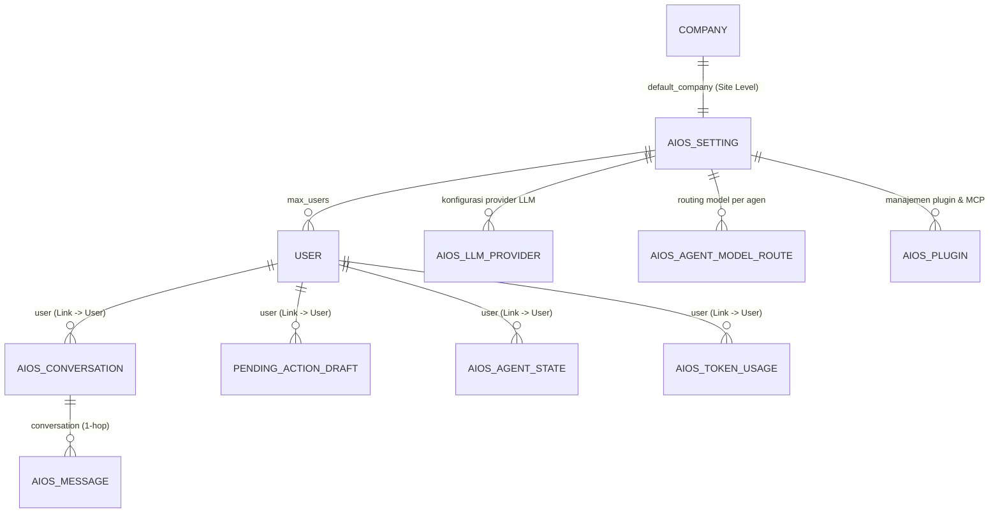

# 03 — Skema Data, Identitas Frappe (`User`), & Arsitektur `1 Client = 1 Site`

Dokumen ini mendefinisikan struktur data, pengelolaan identitas pengguna di atas Frappe 16, konsep **Site-Level Multi-Tenancy (`1 Client = 1 Site`)**, registry Developer Control Plane, pendaftaran Custom Field & Custom DocPerm via hook `after_install` & `after_migrate` (**tanpa `fixtures`**), serta aturan rekayasa anti-bocor yang mengikat seluruh sistem AIOS V1.

---

## 1. Penghapusan `AIOS Tenant` & Pemusatan Atribut di `User` + `AIOS Setting`

Pada kode lama sebelum refactoring, sistem membuat DocType `AIOS Tenant` karena mengasumsikan banyak klien berbagi satu database yang sama (*1 Client = 1 Company di dalam 1 Site*).

Sesuai arahan arsitektur **`1 Client = 1 Site` (`dns_multitenant` Frappe)**:
- **1 Site = 1 Klien (Database Terpisah):** Setiap perusahaan klien memiliki *instance site* dan database MariaDB terpisah. Seluruh data ERPNext (`Company`, `Sales Order`, `Sales Invoice`, `GL Entry`) di dalam suatu *site* adalah milik klien tersebut.
- **`AIOS Tenant` Dihapus Total:** Karena *site* itu sendiri sudah merepresentasikan organisasi klien, DocType `AIOS Tenant` menjadi redundan dan **dihapus sepenuhnya** (termasuk menghapus query ke `tabAIOS Tenant` di `monitoring_service.py` dan `dispatcher.py`).
- **Semua Atribut Operasional Ditaruh di `User` & Konfigurasi Site di `AIOS Setting`:**

### 1.1. Doctype `User` Bawaan Frappe (Identitas, Status, Persona, & Kuota Per-User)
- **Fungsi:** Mengelola kredensial login, sesi (`sid`), *brute-force lockout* (`LoginAttemptTracker`), Role Profile, persona AI, status aktivasi/provisioning, dan kuota token pengguna.
- **Pendaftaran Custom Field via `after_install` & `after_migrate` (Bukan `fixtures` & Bukan UI):**
  - Di Frappe 16 (`frappe/model/__init__.py:103-122`), DocType `User` termasuk dalam `core_doctypes_list`, sehingga UI *Customize Form* menolak penambahan field ke `User` (`custom_field.py:281-282`).
  - Kita **dilarang keras** memodifikasi `tabDocField` secara langsung via `frappe.get_doc("DocType", "User").append("fields", ...)`, dan **tidak menaruh Custom Field di `fixtures` JSON**.
  - **Standar Resmi yang Dipakai:** Seluruh Custom Field pada `User` didefinisikan di satu modul Python terpusat (`aios_v1/setup.py`) menggunakan fungsi resmi **`create_custom_fields(USER_CUSTOM_FIELDS, update=True)`** (`frappe.custom.doctype.custom_field.custom_field`), diikuti pemanggilan eksplisit `frappe.clear_cache(doctype="User")` dan `frappe.db.updatedb("User")` pada hook **`after_install` dan `after_migrate`** di `hooks.py`.
- **Daftar Custom Field pada `User` (Fieldtype Dikunci Permanen Agar Tidak Melanggar `ALLOWED_FIELDTYPE_CHANGE`):**
  1. `aios_persona` (`Select`: `executive`, `finance`, `sales`, `operations`, `system` — jabatan utama pengguna).
  2. `aios_persona_context` (`Small Text`: instruksi/preferensi gaya bahasa spesifik pengguna tersebut).
  3. `aios_status` (`Select`: `Pending Provisioning`, `Active`, `Suspended` — sumber kebenaran tunggal status akses AIOS).
  4. `aios_company_name` (`Data`: menyimpan nama perusahaan yang diinput saat form registrasi mandiri).
  5. `aios_token_limit` (`Int`: **tidak dipakai sebagai gerbang pada PoC**; kuota token bersifat site-level di `AIOS Setting.site_token_limit`. Field ini dihapus di `#5`).
  6. `aios_tokens_used` (`Int`, `read_only=1`: akumulasi token yang telah dipakai oleh user tersebut; **wajib** di-update secara atomik menggunakan SQL increment / `frappe.qb`, **dilarang keras** menggunakan `user_doc.save()` agar tidak memicu *lost update race condition* maupun 22 validasi/`enqueue` di `User.on_update`).

### 1.2. Matriks Otoritatif `User.aios_status` × `User.enabled`
Karena `frappe/auth.py:286` secara native hanya memeriksa `User.enabled`, maka `aios_status` ditetapkan sebagai **sumber kebenaran tunggal (*single source of truth*)** dan `User.enabled` disinkronkan otomatis di `User.validate` (`doc.enabled = 1 if doc.aios_status == "Active" else 0`):

| `aios_status` | `User.enabled` (Otomatis) | `send_welcome_email` | Boleh Login (`/login` & API)? | Keterangan |
|---|---|---|---|---|
| **`Pending Provisioning`** | **`0`** | **`0`** (`flags.no_welcome_mail = True`) | **TIDAK (Ditolak di 3 lapis)** | Baru mendaftar mandiri di `/aios/register`, menunggu site/akun diaktifkan |
| **`Active`** | **`1`** | Sesuai kebijakan Admin | **YA** | Akun aktif di site klien |
| **`Suspended`** | **`0`** | **`0`** | **TIDAK (Sesi aktif langsung di-clear)** | Akun dibekukan oleh `AIOS Admin` |

> **Pertahanan 3 Lapis (`Defense-in-Depth`) untuk `Pending Provisioning` & `Suspended`:**
> 1. **Lapis 1 (Matikan Welcome Email Reset Password):** Saat membuat `User` melalui `/aios/register`, set `user.send_welcome_email = 0` dan `user.flags.no_welcome_mail = True` (`user.py:463`) agar Frappe tidak mengirim email berisi link `/update-password?key=...`.
> 2. **Lapis 2 (Sinkronisasi `enabled = 0`):** Selama `aios_status != "Active"`, `User.enabled` bernilai `0` sehingga `LoginManager.authenticate()` (`frappe/auth.py:286`) menolak login secara native.
> 3. **Lapis 3 (`on_login` & `auth_hooks` di `hooks.py`):** Hook `on_login` (`auth.py:172`, sebelum `make_session`) dan `auth_hooks` (`auth.py:750`, setiap request) membaca `frappe.db.get_value("User", user, "aios_status")` (tanpa cache) dan melempar `frappe.AuthenticationError` bila status bukan `"Active"`.

### 1.3. Doctype `AIOS Setting` (`Single DocType` Tingkat Site)
Menyimpan konfigurasi dan plafon default tingkat *site* (agar tidak ada angka gaib yang di-hardcode di kode Python). Sebagian field model disalin dari site developer; sisanya diisi `Administrator` saat provisioning:
- `default_company` (`Link -> Company`): Perusahaan ERPNext utama yang dioperasikan oleh agen AI pada *site* ini.
  - **Resolusi 100% Site-Level:** Dibaca menggunakan `frappe.db.get_single_value("AIOS Setting", "default_company") or frappe.db.get_single_value("Global Defaults", "default_company")`. **Dilarang keras** memakai `frappe.db.get_default("default_company")` karena fungsi tersebut membaca `tabDefaultValue` per-user yang dapat menyebabkan kebocoran lintas-company jika user memiliki default berbeda.
- `site_token_limit` (`Int`, Opsional) & `site_tokens_used` (`Int`, `read_only=1`): Plafon pengaman dan counter materialisasi total konsumsi token satu *site* (di-update atomik via SQL).
- `max_users` (`Int`): Batas jumlah `User` aktif (`enabled = 1`, `aios_status = "Active"`) yang diizinkan di dalam *site* tersebut (divalidasi di `User.validate`).
- `company_context_persona` (`Small Text`): Konteks bisnis tingkat perusahaan yang disertakan ke prompt seluruh agen di *site* tersebut.
- `base_url` (`Data`), `api_key` (`Password`), `model_name` (`Data`), `temperature` (`Float`): konfigurasi **satu model LLM untuk PoC**. Nilainya **disalin dari site developer** lewat endpoint sync konfigurasi, bukan diisi manual per site. Field ini **dihapus di H1** ketika `AIOS LLM Provider` + `AIOS Agent Model Route` menggantikannya (`docs/06`).

> **Kewenangan mengisi `AIOS Setting` (mengikat):** `default_company`, `site_token_limit`, dan `company_context_persona` hanya boleh diisi `Administrator` sekali saat *site* disiapkan. Pengecualian: **field model** (`base_url`, `api_key`, `model_name`, `temperature`) ditulis oleh endpoint sync konfigurasi dari control plane (`docs/03` §1.4). Developer Control Plane tidak pernah menulis field site-level lain.

### 1.4. Developer Control Plane (Registry & Konfigurasi di Site Developer)

Pengelolaan banyak klien lintas *site* dilakukan dari **Developer Control Plane** — satu *site* Frappe khusus developer yang menjalankan dashboard `AIOS Admin`. Registry *site* klien berupa DocType **`AIOS Client Site`** yang **hanya ada di site developer** (bukan di site klien):

- `site_name` (`Data`, unique): hostname *site* klien (mis. `client-1.aios.local`).
- `base_url` (`Data`): URL dasar *site* klien yang dipanggil Control API.
- `company_name` (`Data`): nama perusahaan klien.
- `contact_name` (`Data`) & `contact_email` (`Data`): kontak klien untuk undangan.
- `api_credential` (`Password`, terenkripsi Frappe): token layanan **`AIOS Control`** *site* klien tersebut (di-mask di setiap pesan error/log).
- `status` (`Select`: `Provisioning`, `Active`, `Suspended`, `Decommissioned`): status *site* klien.
- `last_seen` (`Datetime`, read-only): keberhasilan health check terakhir.
- `last_error` (`Small Text`, read-only): pesan aman dari kegagalan panggilan terakhir (tanpa detail internal mentah).
- `notes` (`Small Text`): catatan operator.

**Aturan penting:**
1. **Tidak ada DocType `plan`, billing, atau tiering** pada tahap ini; kuota PoC = satu gerbang site — `AIOS Setting.site_token_limit` vs `site_tokens_used` (per site klien). `User.aios_tokens_used` hanya statistik harian, bukan gerbang; registry `AIOS Client Site` (opsional) untuk ringkasan lintas site.
2. **Ownership tetap per `User` di site klien.** Control plane tidak pernah menulis data bisnis klien; ia mengelola lifecycle (`aios_status`), menyalin konfigurasi operator, dan membaca agregat monitoring via role `AIOS Control`.
3. **`Administrator` di site klien tidak dipakai oleh control plane harian.** Job provisioning awal memakai `Administrator` hanya untuk setup wizard dan `AIOS Setting`; jalur programatik harian (lifecycle, monitoring, **sync konfigurasi**) memakai token role `AIOS Control` (bukan `AIOS Admin`, bukan `Administrator`).
4. **Role `AIOS Control`** di site klien: service role tanpa login manusia — `read` pada `User` dan `AIOS Token Usage`, plus **satu endpoint tulis sempit untuk sync konfigurasi** yang hanya menyentuh field model `AIOS Setting` (dan, setelah H1/H2, DocType konfigurasi operator). Tidak ada akses ke DocType bisnis/ERPNext dan tidak ada `DocPerm write` umum pada `AIOS Setting`. Aksinya diekspos lewat endpoint Control API (`/api/control/...`) yang memvalidasi token `api_credential` dan menolak sesi manusia.
5. **Tulis lifecycle lewat pintu sempit, bukan `DocPerm`.** `AIOS Control` **tidak** memegang `write = 1` pada `User` (karena `DocPerm` tidak bisa membatasi per-field, sehingga `write` akan membuka password/role/`enabled`). Perubahan `aios_status` dilakukan oleh endpoint Control API khusus yang hanya menyentuh field itu via `frappe.db.set_value`, tercatat audit. Kuota token tidak ditulis dari control plane (site-level, `Administrator` saat provisioning).
6. **`AIOS Admin` hanya di site developer** (target `desk_access = 0`); site klien tidak memiliki role `AIOS Admin`.
7. **Angka kuota site diambil dari endpoint metrics, bukan dari `AIOS Setting`.** Endpoint mengembalikan angka agregat (`site_tokens_used`, jumlah user aktif) tanpa mengekspos isi dokumen.
8. Panggilan keluar dari control plane melewati **allowlist `base_url` registry + wajib HTTPS** di non-lokal, dengan SSRF guard yang sama seperti plugin `web-market-research` (blokir RFC1918/loopback/link-local/cloud metadata, re-check tiap redirect).
9. **Data yang boleh tampil di dashboard (mengikat):** **nama dan email `User`** — diperlukan agar `AIOS Admin` bisa mengirim undangan — beserta `aios_status`, `aios_persona`, kuota, dan pemakaian token. **Yang tidak boleh tampil:** password/hash, API key/`api_credential`, isi `AIOS Setting` (`company_context_persona`), dan seluruh data bisnis/ERPNext.

**Sumber kebenaran konfigurasi operator:** model LLM, provider, dan plugin bersumber dari site developer dan disalin ke tiap site klien lewat Control API. Site klien menyimpan salinan lokal yang dipakai saat runtime. Sync hanya menyentuh field/DocType konfigurasi operator — tidak pernah data bisnis, `default_company`, `site_token_limit`, atau `company_context_persona`.

---

## 2. Peta Doctype AIOS & Matriks Permission (Site Klien: `AIOS Client` / `AIOS Control`)

Seluruh DocType operasional AIOS berelasi langsung ke **`User`** (`user -> Link(User)`) — kecuali registry `AIOS Client Site` yang hanya ada di *site developer* (`docs/03` §1.4).

> Dokumen ini menetapkan **bentuk akhir** semua DocType, termasuk yang belum ada di kode. Status implementasi per DocType ada di `docs/05.1` §1.3.

> **DocType adapter DB eksternal dihapus:** `AIOS DB Connection`, `AIOS Mapping`, `AIOS Mapping Entry`, dan `AIOS Schema Snapshot` tidak lagi bagian dari skema. PoC bersifat **ERPNext-first** — data bisnis dibaca langsung dari ERPNext site klien, bukan dari database luar. Alasannya: pemetaan kolom tetap tidak mampu menangani variasi skema klien (jumlah kolom, tipe data, penamaan), sehingga modelnya tidak dapat dipertahankan.

### 2.1. Matriks `DocPerm` / `Custom DocPerm` (Di-script di `after_install` & `after_migrate`)
Karena `has_permission` di Frappe hanya dapat **menolak (DENY)** dan tidak dapat memberikan izin jika `DocPerm` dasar belum ada (`frappe/permissions.py:486-499`), serta plugin `erpnext-core-data` (`frappe.get_list`) dan `erpnext-financial-reports` (`frappe.desk.query_report.run` di `query_report.py:289`) membutuhkan izin `read=1` dan `report=1` pada DocType ERPNext, maka matriks izin berikut wajib dipasang:

Matriks ini berlaku di **site klien**. Di site developer, `AIOS Admin` bekerja lewat dashboard control plane dan endpoint management-nya sendiri; ia tidak memegang DocPerm ERPNext. `AIOS Control` adalah service role yang aksinya diekspos lewat Control API, bukan login Desk:

| Kelompok DocType | Daftar DocType | Izin `AIOS Client` (`desk_access=0`) | Izin `AIOS Control` (service) | Izin `AIOS Admin` (hanya site developer) |
|---|---|---|---|---|
| **DocType ERPNext Target (via `add_permission` / `Custom DocPerm` di `setup.py`)** | `Sales Order`, `Sales Invoice`, `Delivery Note`, `Payment Entry`, `Journal Entry`, `GL Entry`, `Customer`, `Supplier`, `Item`, `Company`, `Account` | **`read = 1, report = 1`**, `create/write/delete = 0` (aksi tulis wajib lewat `Pending Action Draft`) | **`—`** (tidak ada akses data bisnis) | — (tidak ada di site klien) |
| **DocType AIOS Kepemilikan Langsung (`user -> Link(User)`)** | `AIOS Conversation`, `Pending Action Draft`, `AIOS Agent State` | `read = 1, write = 1, create = 1, delete = 1` (dibatasi `user = session.user` via `permission_query_conditions` & `has_permission`) | **`—`** | — (tidak ada di site klien) |
| **DocType AIOS Log & Join (`1-hop`)** | `AIOS Message`, `AIOS Token Usage` | `read = 1` (khusus miliknya via `permission_query_conditions` & `has_permission`) | `read = 1` **hanya pada `AIOS Token Usage`**; lainnya `—` | — (tidak ada di site klien) |
| **DocType Konfigurasi & Rahasia Admin** | `AIOS Setting`, `AIOS LLM Provider`, `AIOS Agent Model Route`, `AIOS Plugin`, `AIOS Telegram Setting`, `AIOS Telegram Session`, `AIOS Telegram Message` | **Tidak ada akses (`read = 0`)** + ditolak eksplisit di `has_permission` | **`—`** (termasuk `AIOS Setting`; tulis lifecycle dan sync konfigurasi lewat endpoint khusus, bukan `DocPerm`) | — (tidak ada di site klien) |

> **Batas peran `Administrator` (mengikat, berlaku saat izin dipasang):**
> - **`Administrator` tidak dibatasi dan tidak pernah dimodifikasi.** Di Frappe, `Administrator` sudah melewati seluruh cek izin (`frappe/permissions.py:108,306`). Maka **jangan** menambahkan `Administrator` ke permission role AIOS: baris izin seperti itu tidak memberi kemampuan apa pun (memang sudah ada) dan hanya menyesatkan pembaca berikutnya. Control plane **wajib** memakai role `AIOS Control`, bukan `Administrator`.
> - **`AIOS Control` bukan `AIOS Admin` dan bukan `Administrator`.** Ia hanya punya `read` pada `User` dan `AIOS Token Usage`, plus satu endpoint sync konfigurasi yang sempit. Setiap penambahan izin baru ke role ini adalah keputusan keamanan, bukan detail teknis.
> - **`AIOS Admin` bukan `Administrator`.** `AIOS Admin` adalah role Frappe biasa untuk operator di site developer (dibuat oleh `Administrator`), bukan pemegang kunci skema dan **tidak dipasang di site klien**. `AIOS Client` ber-`desk_access = 0` (Website User) sehingga tidak menambah seat desk Frappe.

### 2.2. Lima Lapis Pertahanan Isolasi Data
1. **Lapis 1 — Isolasi Database Penuh Antar-Klien (`1 Client = 1 Site`):**
   - Setiap perusahaan klien berada di database MariaDB dan direktori `sites/<site_name>/` yang terpisah secara fisik di level Frappe Bench (`dns_multitenant`).
2. **Lapis 2 — Sesi, Sinkronisasi `aios_status` ↔ `enabled`, & CSRF Frappe:**
   - Seluruh endpoint memvalidasi sesi login Frappe (`frappe.session.user != "Guest"`), memastikan `User.aios_status == "Active"` (`on_login` & `auth_hooks`), dan memverifikasi header `X-Frappe-CSRF-Token` yang di-bootstrap lewat `frappe.sessions.get_csrf_token()`.
3. **Lapis 3 — Isolasi Baris & Dokumen Antar-User (`permission_query_conditions` + `has_permission` + `check_permission="read"`):**
   - `permission_query_conditions` memastikan `AIOS Client` hanya melihat baris dengan `user = frappe.session.user` (menolak `NULL`) untuk DocType milik AIOS. Untuk DocType ERPNext di `ERP_CLIENT_DOCTYPES`, hook `erp_company_query_conditions` + `erp_company_has_permission` (`aios_v1/permissions.py`, terdaftar di `hooks.py` dari satu sumber `ERP_CLIENT_DOCTYPES`) menyempitkan `AIOS Client` ke company aktif (`AIOS Setting.default_company`, fallback `Global Defaults`): DocType ber-field `company` difilter `company = <aktif>`, DocType `Company` difilter `name = <aktif>`, DocType tanpa field `company` (mis. Customer/Supplier/Item) tidak di-scope, dan tanpa company aktif hasilnya fail-closed (`1=0`). Administrator/AIOS Admin bypass penuh. Pembatasan company di layer tool via injeksi `allowed_company` (Lapis 4) tetap berlaku di atasnya.
   - Script report ERPNext memakai raw SQL yang hanya menghormati `filters.company` yang dipanggil (AR bahkan mengisi ulang dari `Global Defaults` bila kosong), sehingga layer permission tidak menutupnya: entry `frappe.desk.query_report.run` dibungkus guard `aios_v1.api.report_guard.run_query_report` via `override_whitelisted_methods`. Untuk `AIOS Client`: report dibatasi `ALLOWED_REPORTS`, `filters["company"]` dipaksa ke company aktif, prepared report dimatikan, filter tidak valid ditolak, dan tanpa company aktif fail-closed. User lain (Administrator/AIOS Admin/System User) pass-through tanpa perubahan.
   - `has_permission` menutup pembacaan langsung lintas-user pada `frappe.get_doc`.
   - Seluruh pemanggilan `frappe.get_doc(doctype, name, check_permission="read")` di lapisan tool/API wajib menyertakan argumen `check_permission="read"` karena default `frappe.get_doc` (`document.py:186`) adalah `check_permission=None`.
4. **Lapis 4 — Injeksi Konteks `Company` Site-Level & Update Kuota Atomik di Lapisan Tool (`execute_tool`):**
   - `execute_tool` mengambil `user_id = frappe.session.user` dan menyuntikkan `allowed_company` yang dibaca dari `frappe.db.get_single_value("AIOS Setting", "default_company") or frappe.db.get_single_value("Global Defaults", "default_company")`.
   - Pemakaian token dicatat ke `AIOS Token Usage` dan di-increment secara atomik via SQL pada `User.aios_tokens_used`.
5. **Lapis 5 — Batas Wewenang Control Plane (`AIOS Control` + Control API):**
   - Control plane hanya berbicara ke *site* klien lewat Control API (`/api/control/...`) dengan token `api_credential` milik role `AIOS Control`; token di-mask di setiap pesan error/log.
   - Endpoint Control API menolak sesi login manusia, mencatat setiap panggilan (audit), dan hanya mengizinkan operasi lifecycle (`aios_status`, health check, agregat monitoring) serta **sync konfigurasi operator** — **bukan data bisnis**.
   - `AIOS Control` hanya memegang `read` pada `User` dan `AIOS Token Usage`, plus satu endpoint sync konfigurasi. Tulis lifecycle dijalankan endpoint khusus yang menyentuh hanya `aios_status` via `frappe.db.set_value` — bukan `DocPerm write` pada `User`.
