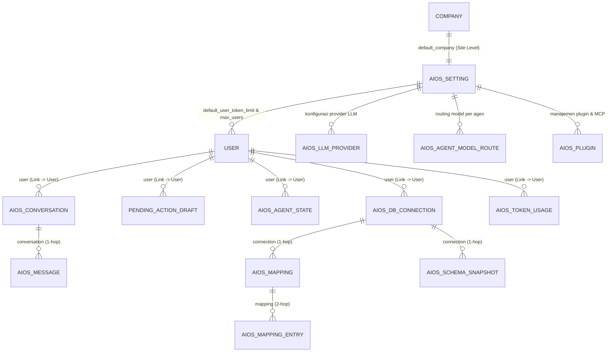

# 03 — Skema Data, Identitas Frappe (`User`), & Arsitektur `1 Client = 1 Site`

Dokumen ini mendefinisikan struktur data, pengelolaan identitas pengguna di atas Frappe 16, konsep **Site-Level Multi-Tenancy (`1 Client = 1 Site`)**, pendaftaran Custom Field & Custom DocPerm via hook `after_install` & `after_migrate` (**tanpa `fixtures`**), serta aturan rekayasa anti-bocor yang mengikat seluruh sistem AIOS V1.

---

## 1. Penghapusan `AIOS Tenant` & Pemusatan Atribut di `User` + `AIOS Setting`

Pada kode lama sebelum refactoring, sistem membuat DocType `AIOS Tenant` karena mengasumsikan banyak klien berbagi satu database yang sama (*1 Client = 1 Company di dalam 1 Site*).

Sesuai arahan arsitektur **`1 Client = 1 Site` (`dns_multitenant` Frappe)**:
- **1 Site = 1 Klien (Database Terpisah):** Setiap perusahaan klien memiliki *instance site* dan database MariaDB terpisah. Seluruh data ERPNext (`Company`, `Sales Order`, `Sales Invoice`, `GL Entry`) di dalam suatu *site* adalah milik klien tersebut.
- **`AIOS Tenant` Dihapus Total:** Karena *site* itu sendiri sudah merepresentasikan organisasi klien, DocType `AIOS Tenant` menjadi redundan dan **dihapus sepenuhnya** (termasuk menghapus query ke `tabAIOS Tenant` di `monitoring_service.py` dan `dispatcher.py`).
- **Semua Atribut Operasional Ditaruh di `User` & Konfigurasi Site di `AIOS Setting`:**

### 1.1. Doctype `User` Bawaan Frappe (Identitas, Status, Persona, & Kuota Per-User)
- **Fungsi:** Mengelola kredensial login, sesi (`sid`), *brute-force lockout* (`LoginAttemptTracker`), Role Profile, persona AI, status aktivasi/provisioning, dan kuota token pengguna.
- **Pendaftaran Custom Field via `after_install` & `after_migrate` (Bukan `fixtures` & Bukan UI):**
  - Di Frappe 16 (`frappe/model/__init__.py:103-122`), DocType `User` termasuk dalam `core_doctypes_list`, sehingga UI *Customize Form* menolak penambahan field ke `User` (`custom_field.py:281-282`).
  - Kita **dilarang keras** memodifikasi `tabDocField` secara langsung via `frappe.get_doc("DocType", "User").append("fields", ...)`, dan **tidak menaruh Custom Field di `fixtures` JSON**.
  - **Standar Resmi yang Dipakai:** Seluruh Custom Field pada `User` didefinisikan di satu modul Python terpusat (`aios_v1/setup.py`) menggunakan fungsi resmi **`create_custom_fields(USER_CUSTOM_FIELDS, update=True)`** (`frappe.custom.doctype.custom_field.custom_field`), diikuti pemanggilan eksplisit `frappe.clear_cache(doctype="User")` dan `frappe.db.updatedb("User")` pada hook **`after_install` dan `after_migrate`** di `hooks.py`.
- **Daftar Custom Field pada `User` (Fieldtype Dikunci Permanen Agar Tidak Melanggar `ALLOWED_FIELDTYPE_CHANGE`):**
  1. `aios_persona` (`Select`: `executive`, `finance`, `sales`, `operations`, `system` — jabatan utama pengguna).
  2. `aios_persona_context` (`Small Text`: instruksi/preferensi gaya bahasa spesifik pengguna tersebut).
  3. `aios_status` (`Select`: `Pending Provisioning`, `Active`, `Suspended` — sumber kebenaran tunggal status akses AIOS).
  4. `aios_company_name` (`Data`: menyimpan nama perusahaan yang diinput saat form registrasi mandiri).
  5. `aios_token_limit` (`Int`: batas kuota token individu user tersebut; nilai awalnya otomatis disalin dari `AIOS Setting.default_user_token_limit` saat user dibuat, dan dapat disesuaikan per user oleh `AIOS Admin`).
  6. `aios_tokens_used` (`Int`, `read_only=1`: akumulasi token yang telah dipakai oleh user tersebut; **wajib** di-update secara atomik menggunakan SQL increment / `frappe.qb`, **dilarang keras** menggunakan `user_doc.save()` agar tidak memicu *lost update race condition* maupun 22 validasi/`enqueue` di `User.on_update`).

### 1.2. Matriks Otoritatif `User.aios_status` × `User.enabled`
Karena `frappe/auth.py:286` secara native hanya memeriksa `User.enabled`, maka `aios_status` ditetapkan sebagai **sumber kebenaran tunggal (*single source of truth*)** dan `User.enabled` disinkronkan otomatis di `User.validate` (`doc.enabled = 1 if doc.aios_status == "Active" else 0`):

| `aios_status` | `User.enabled` (Otomatis) | `send_welcome_email` | Boleh Login (`/login` & API)? | Keterangan |
|---|---|---|---|---|
| **`Pending Provisioning`** | **`0`** | **`0`** (`flags.no_welcome_mail = True`) | **TIDAK (Ditolak di 3 lapis)** | Baru mendaftar mandiri di `/aios/register`, menunggu site/akun diaktifkan |
| **`Active`** | **`1`** | Sesuai kebijakan Admin | **YA** | Akun aktif di site klien |
| **`Suspended`** | **`0`** | **`0`** | **TIDAK (Sesi aktif langsung di-clear)** | Akun dibekukan oleh `AIOS Admin` |

> **Pertahanan 3 Lapis (`Defense-in-Depth`) untuk `Pending Provisioning` & `Suspended`:**
> 1. **Lapis 1 (Matikan Welcome Email Reset Password):** Saat membuat `User` melalui `/aios/register`, set `user.send_welcome_email = 0` dan `user.flags.no_welcome_mail = True` (`user.py:463`) agar Frappe tidak mengirim email berisi link `/update-password?key=...`.
> 2. **Lapis 2 (Sinkronisasi `enabled = 0`):** Selama `aios_status != "Active"`, `User.enabled` bernilai `0` sehingga `LoginManager.authenticate()` (`frappe/auth.py:286`) menolak login secara native.
> 3. **Lapis 3 (`on_login` & `auth_hooks` di `hooks.py`):** Hook `on_login` (`auth.py:172`, sebelum `make_session`) dan `auth_hooks` (`auth.py:750`, setiap request) membaca `frappe.db.get_value("User", user, "aios_status")` (tanpa cache) dan melempar `frappe.AuthenticationError` bila status bukan `"Active"`.

### 1.3. Doctype `AIOS Setting` (`Single DocType` Tingkat Site)
Menyimpan konfigurasi dan plafon default tingkat *site* (agar tidak ada angka gaib yang di-hardcode di kode Python):
- `default_company` (`Link -> Company`): Perusahaan ERPNext utama yang dioperasikan oleh agen AI pada *site* ini.
  - **Resolusi 100% Site-Level:** Dibaca menggunakan `frappe.db.get_single_value("AIOS Setting", "default_company") or frappe.db.get_single_value("Global Defaults", "default_company")`. **Dilarang keras** memakai `frappe.db.get_default("default_company")` karena fungsi tersebut membaca `tabDefaultValue` per-user yang dapat menyebabkan kebocoran lintas-company jika user memiliki default berbeda.
- `default_user_token_limit` (`Int`): Nilai kuota token awal yang diberikan secara otomatis ke setiap `User` baru saat dibuat/diaktifkan.
- `site_token_limit` (`Int`, Opsional) & `site_tokens_used` (`Int`, `read_only=1`): Plafon pengaman dan counter materialisasi total konsumsi token satu *site* (di-update atomik via SQL).
- `max_users` (`Int`): Batas jumlah `User` aktif (`enabled = 1`, `aios_status = "Active"`) yang diizinkan di dalam *site* tersebut (divalidasi di `User.validate`).
- `company_context_persona` (`Small Text`): Konteks bisnis tingkat perusahaan yang disertakan ke prompt seluruh agen di *site* tersebut.

---

## 2. Peta Doctype AIOS & Matriks Permission (`AIOS Client` vs `AIOS Admin`)

Seluruh DocType operasional AIOS berelasi langsung ke **`User`** (`user -> Link(User)`):

### 2.1. Matriks `DocPerm` / `Custom DocPerm` (Di-script di `after_install` & `after_migrate`)
Karena `has_permission` di Frappe hanya dapat **menolak (DENY)** dan tidak dapat memberikan izin jika `DocPerm` dasar belum ada (`frappe/permissions.py:486-499`), serta plugin `erpnext-core-data` (`frappe.get_list`) dan `erpnext-financial-reports` (`frappe.desk.query_report.run` di `query_report.py:289`) membutuhkan izin `read=1` dan `report=1` pada DocType ERPNext, maka matriks izin berikut wajib dipasang:

| Kelompok DocType | Daftar DocType | Izin `AIOS Client` (`desk_access=0`) | Izin `AIOS Admin` (`desk_access=1`) |
|---|---|---|---|
| **DocType ERPNext Target (via `add_permission` / `Custom DocPerm` di `setup.py`)** | `Sales Order`, `Sales Invoice`, `Delivery Note`, `Payment Entry`, `Journal Entry`, `GL Entry`, `Customer`, `Supplier`, `Item`, `Company`, `Account` | **`read = 1, report = 1`**, `create/write/delete = 0` (aksi tulis wajib lewat `Pending Action Draft`) | `read = 1, report = 1, write = 1, create = 1` |
| **DocType AIOS Kepemilikan Langsung (`user -> Link(User)`)** | `AIOS Conversation`, `Pending Action Draft`, `AIOS DB Connection`, `AIOS Agent State` | `read = 1, write = 1, create = 1, delete = 1` (dibatasi `user = session.user` via `permission_query_conditions` & `has_permission`) | Akses Penuh (`read/write/create/delete`) |
| **DocType AIOS Log & Join (`1-hop` / `2-hop`)** | `AIOS Message`, `AIOS Token Usage`, `AIOS Mapping`, `AIOS Schema Snapshot`, `AIOS Mapping Entry` | `read = 1` (khusus miliknya via `permission_query_conditions` & `has_permission`) | Akses Penuh |
| **DocType Konfigurasi & Rahasia Admin** | `AIOS Setting`, `AIOS LLM Provider`, `AIOS Agent Model Route`, `AIOS Plugin`, `AIOS Telegram Setting`, `AIOS Telegram Session`, `AIOS Telegram Message` | **Tidak ada akses (`read = 0`)** + ditolak eksplisit di `has_permission` | Akses Penuh (`read/write/create/delete`) |

### 2.2. Empat Lapis Pertahanan Isolasi Data
1. **Lapis 1 — Isolasi Database Penuh Antar-Klien (`1 Client = 1 Site`):**
   - Setiap perusahaan klien berada di database MariaDB dan direktori `sites/<site_name>/` yang terpisah secara fisik di level Frappe Bench (`dns_multitenant`).
2. **Lapis 2 — Sesi, Sinkronisasi `aios_status` ↔ `enabled`, & CSRF Frappe:**
   - Seluruh endpoint memvalidasi sesi login Frappe (`frappe.session.user != "Guest"`), memastikan `User.aios_status == "Active"` (`on_login` & `auth_hooks`), dan memverifikasi header `X-Frappe-CSRF-Token` yang di-bootstrap lewat `frappe.sessions.get_csrf_token()`.
3. **Lapis 3 — Isolasi Baris & Dokumen Antar-User (`permission_query_conditions` + `has_permission` + `check_permission="read"`):**
   - `permission_query_conditions` memastikan `AIOS Client` hanya melihat baris dengan `user = frappe.session.user` (menolak `NULL`) dan memfilter DocType ERPNext ke `company = default_company` site.
   - `has_permission` menutup pembacaan langsung lintas-user pada `frappe.get_doc`.
   - Seluruh pemanggilan `frappe.get_doc(doctype, name, check_permission="read")` di lapisan tool/API wajib menyertakan argumen `check_permission="read"` karena default `frappe.get_doc` (`document.py:186`) adalah `check_permission=None`.
4. **Lapis 4 — Injeksi Konteks `Company` Site-Level & Update Kuota Atomik di Lapisan Tool (`execute_tool`):**
   - `execute_tool` mengambil `user_id = frappe.session.user` dan menyuntikkan `allowed_company` yang dibaca dari `frappe.db.get_single_value("AIOS Setting", "default_company") or frappe.db.get_single_value("Global Defaults", "default_company")`.
   - Pemakaian token dicatat ke `AIOS Token Usage` dan di-increment secara atomik via SQL pada `User.aios_tokens_used`.
