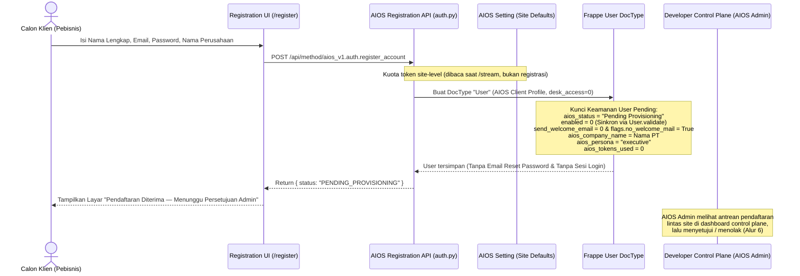
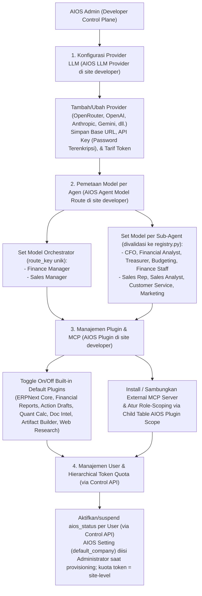
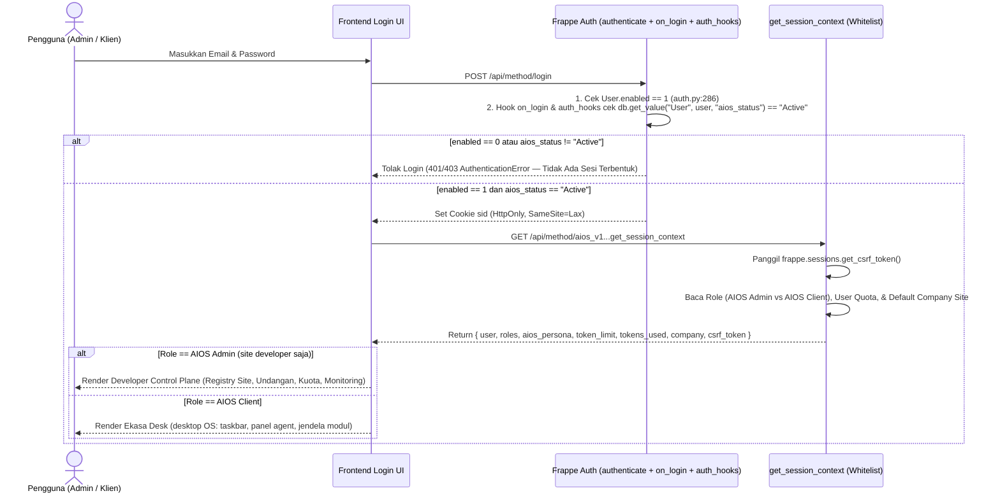
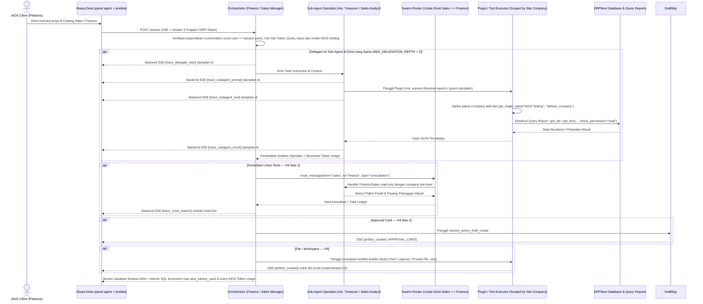
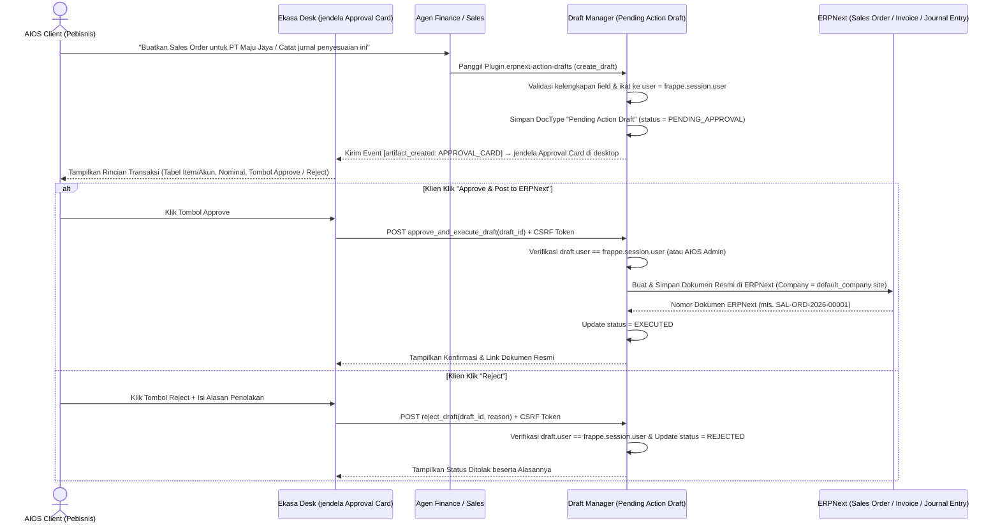
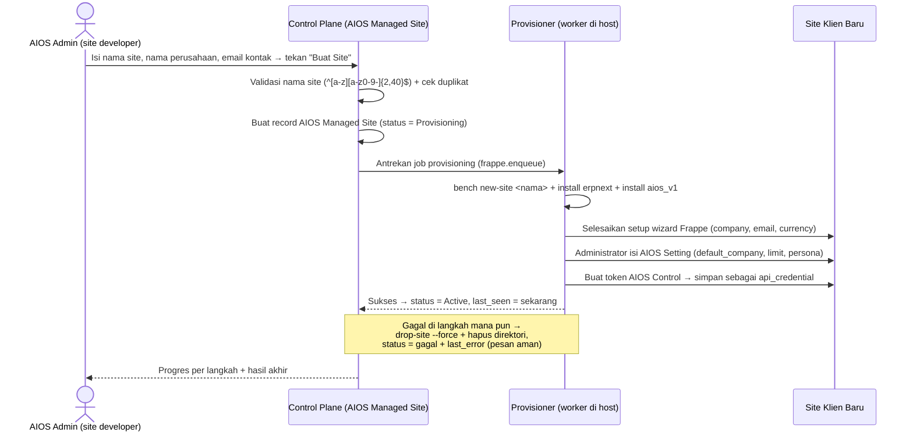
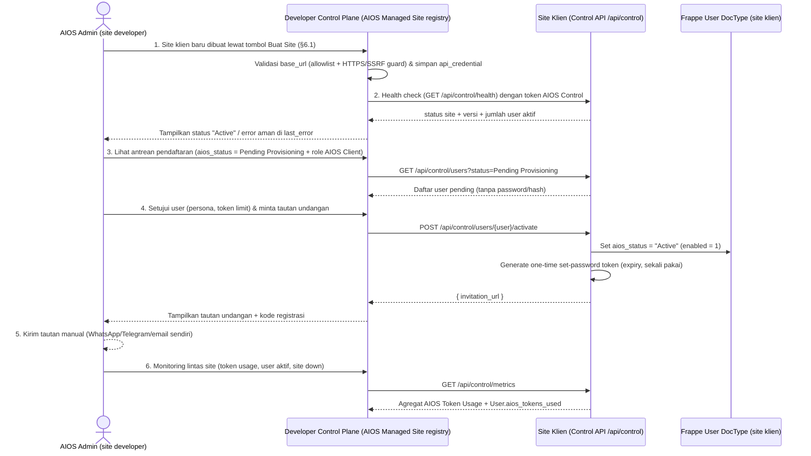
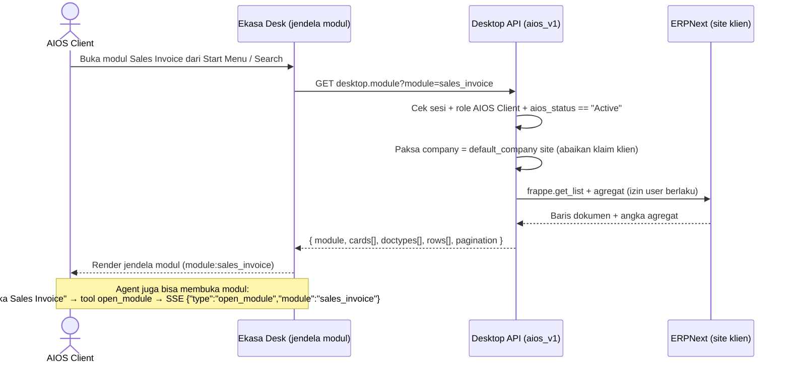

# 04 — Alur Kerja Sistem (End-to-End Workflows)

Dokumen ini menggambarkan 7 alur kerja utama di dalam AIOS V1 dari awal pendaftaran pengguna hingga eksekusi kolaborasi agen, persetujuan transaksi di ERPNext, pengelolaan lintas site dari Developer Control Plane, dan pembacaan modul di desktop. Setiap alur disajikan dalam bentuk diagram **Mermaid** sekaligus **rincian langkah teknis bernomor** agar mudah dibaca manusia maupun diproses oleh AI agent.

---

## Alur 1 — *Self-Service Registration* (`/register` — *Pending Provisioning*) & Aktivasi User via Control Plane

Karena arsitektur multi-tenant AIOS V1 adalah **`1 Client = 1 Site`** (setiap perusahaan klien memiliki *instance site* dan database tersendiri), pendaftaran mandiri di halaman web tidak langsung membuat `Company` dadakan atau *auto-login* ke workspace, melainkan masuk ke status **`Pending Provisioning`** pada DocType `User` dengan `enabled = 0` dan tanpa pengiriman email *reset password* otomatis. **Aktivasi akun dan penerbitan undangan dilakukan oleh `AIOS Admin` dari Developer Control Plane** (Alur 6), bukan oleh operator di site klien.

### Rincian Langkah Alur 1:
1. **Input Registrasi Mandiri:** Calon klien mengisi Nama Lengkap, Email, Password, dan Nama Perusahaan/PT pada halaman `/register`.
2. **Validasi & Proteksi Enumerasi:** Endpoint registrasi (`@frappe.whitelist(allow_guest=True)` + `@rate_limit`) memvalidasi input dan menerapkan respons seragam agar tidak dapat disalahgunakan untuk enumerasi email.
3. **Kuota Token Site-Level:** Registrasi tidak menyalin kuota per user; gerbang kuota dibaca dari `AIOS Setting.site_token_limit` saat `/stream` (Alur 4), bukan saat registrasi.
4. **Pembuatan Akun `User` Terkunci (`Pending Provisioning`):**
   - Sistem membuat dokumen `User` bawaan Frappe dengan Role `AIOS Client` (`user_type = "Website User"`, `desk_access = 0`).
   - Mematikan pengiriman email sambutan/reset password bawaan Frappe (`user.send_welcome_email = 0` dan `user.flags.no_welcome_mail = True`) sehingga user yang belum di-provision tidak menerima link `/update-password`.
   - Mengisi Custom Field pada `User`:
     - `aios_status = "Pending Provisioning"` (yang secara otomatis menyetel `User.enabled = 0` di `User.validate` sehingga `/login` standar Frappe juga tertutup rapat).
     - `aios_company_name = company_name`
     - `aios_persona = "executive"`
     - `aios_tokens_used = 0`
   - Sistem **tidak** membuat DocType `AIOS Tenant`, **tidak** membuat `Company` ERPNext secara paksa di dalam request tersebut, dan **tidak** melakukan *auto-login* (`login_as`) ke `/aios`.
5. **Tampilan Menunggu Persetujuan:** UI menampilkan informasi bahwa pendaftaran telah diterima dan menunggu persetujuan admin AIOS (dilihat `AIOS Admin` di Developer Control Plane, Alur 6).
6. **Aktivasi via Control Plane:** Setelah disetujui, `AIOS Admin` di control plane menetapkan `aios_persona` (`executive`, `finance`, `sales`), lalu Control API *site* klien menyetel `User.aios_status = "Active"` (yang otomatis mengaktifkan `User.enabled = 1`). Kredensial awal tidak pernah dikirim via email — pengguna diarahkan ke tautan set-password sekali pakai yang dikirim `AIOS Admin` secara manual (WhatsApp/Telegram/email sendiri), lihat Alur 6.

### Model Penyajian Ekasa Desk

Ekasa Desk (`frontend/`) adalah aplikasi Vite yang berjalan **terpisah**
dari site Frappe. Ia tidak di-build ke `aios_v1/public/` dan tidak
dilayani sebagai halaman www Frappe.

**Satu proses frontend melayani semua site klien.** Pemilihan site
dilakukan oleh Frappe dari `Host` header request — mekanisme resmi
Frappe (lihat docs.frappe.io Sites § Site Resolution). Karena itu:

- Akses dev memakai `<site>.localhost:<port>`, bukan `localhost:<port>`.
  Contoh: `aios-4a1-check.localhost:5173`.
- Proxy Vite **tidak boleh menimpa** `Host` header. Override Host membuat
  semua request dilayani sebagai satu site saja, sehingga registrasi
  client masuk ke site yang salah.
- `X-Frappe-Site-Name` adalah header resmi Frappe alternatif bila Host
  tidak bisa dipakai (mis. reverse proxy yang mengganti Host).

Konsekuensi alur: client membuka `<site>.localhost:<port>/register`,
`register_account()` membuat `User` di site itu, dan user pending langsung
terlihat oleh `pending_inbox()` di control plane.

Target backend dan port dev dibaca dari environment (`VITE_BACKEND_TARGET`,
`VITE_DEV_PORT`) — lihat `frontend/.env.example`. Tanpa nilai itu, dev
server gagal start secara eksplisit.

---

## Alur 2 — Konfigurasi Provider, Model Routing, Plugin, & Kuota `User` dari Control Plane

Operator (`AIOS Admin` di Developer Control Plane) mengatur mesin kecerdasan dan kapabilitas tool **sekali untuk semua site klien**. **UI dan sumber kebenaran ada di control plane; konfigurasi disalin ke tiap site klien** (`AIOS LLM Provider`, `AIOS Agent Model Route`, `AIOS Plugin`) — control plane juga menyimpan registry site + kredensial Control API (`docs/03` §1.4).

> **`AIOS Setting` bukan bagian dari alur ini — kecuali field model.** `default_company` dan `company_context_persona` diisi `Administrator` sekali saat *site* disiapkan (`docs/03` §1.3). Field model (`base_url`, `api_key`, `model_name`, `temperature`) disalin dari control plane lewat endpoint sync.

> **Catatan PoC:** alur provider + routing per agen di bawah adalah **target H1 yang ditunda** (`docs/00` §2.3). Pada PoC, model LLM tunggal disalin dari control plane ke `AIOS Setting` site klien (`base_url`, `api_key`, `model_name`, `temperature`); `AIOS LLM Provider` dan `AIOS Agent Model Route` belum ada. Plugin (`AIOS Plugin`) juga baru ada di H2.

### Rincian Langkah Alur 2:
1. **Pendaftaran Provider LLM (`AIOS LLM Provider`):** `AIOS Admin` menambahkan satu atau beberapa provider LLM dari UI control plane, mengisi `base_url`, `api_key` (field `Password` terenkripsi Frappe), daftar model, serta tarif token per model. Data ini tinggal di site developer sebagai sumber kebenaran dan disalin ke tiap site klien lewat Control API.
2. **Pemetaan Model per Peran Agen (`AIOS Agent Model Route`):** `AIOS Admin` memilih provider dan model spesifik untuk masing-masing **Orchestrator** (`Finance Manager`, `Sales Manager`) maupun setiap **Sub-Agent** (`cfo`, `financial-analyst`, `treasurer`, `budgeting-staff`, `finance-staff`, `sales-representative`, `sales-data-analyst`, `customer-service`, `marketing-specialist`), dengan `route_key` unik dan validasi nama agen ke `registry.py`. Konfigurasi ini global; tidak ada pemilihan per site maupun per user.
3. **Kontrak *Fail-Loudly* (Zero Default Hardcode):** Bila ada agen yang dipanggil tetapi belum memiliki rute model aktif di database site developer, sistem langsung menghentikan eksekusi secara eksplisit (`frappe.throw`), mencatat ke `Error Log`, dan tidak pernah jatuh ke model default hardcoded.
4. **Pengaturan Plugin & MCP (`AIOS Plugin`):** `AIOS Admin` mengaktifkan/menonaktifkan *Built-in Default Plugins* maupun menyambungkan server MCP eksternal, serta mengatur hak akses plugin per cabang/sub-agent (*Least Privilege*). Konfigurasi ini global dan disalin ke tiap site klien.
5. **Manajemen Status & Pemakaian Token per `User`:** `AIOS Admin` memantau konsumsi token tiap pengguna (`User.aios_tokens_used` & log `AIOS Token Usage`), lalu mengubah `User.aios_status` (`Active` / `Suspended`) per individu — lewat endpoint Control API dengan token `AIOS Control`, bukan login Desk di site klien. Kuota token berlaku site-level (`AIOS Setting.site_token_limit`); tidak ada plafon per user.

---

## Alur 3 — Autentikasi Sesi, Guard 3 Lapis `aios_status`, Bootstrap CSRF, & Routing Peran

### Rincian Langkah Alur 3:
1. **Login Standar Frappe + Guard 3 Lapis (`enabled`, `on_login`, `auth_hooks`):**
   - `LoginManager.authenticate()` (`frappe/auth.py:286`) menolak user bila `enabled == 0`.
   - Hook `on_login` (`frappe/auth.py:172`, dijalankan sebelum `make_session()`) dan `auth_hooks` (`frappe/auth.py:750`, dijalankan di setiap request) memeriksa `frappe.db.get_value("User", user, "aios_status")` secara langsung dari DB (tanpa cache). Jika nilainya bukan `"Active"`, request langsung dihentikan dengan `frappe.AuthenticationError`.
2. **Penerbitan Cookie Sesi (`sid`):** Jika aktif, Frappe membuat sesi di Redis dan mengirimkan cookie `sid` (`HttpOnly`, `SameSite=Lax`).
3. **Bootstrap Sesi & Token CSRF (`get_session_context`):** Frontend memanggil endpoint `@frappe.whitelist()` `get_session_context()` yang mengeksekusi `frappe.sessions.get_csrf_token()` untuk men-generate token di Redis sekaligus mengembalikannya ke frontend bersama informasi `roles`, `aios_persona`, `aios_token_limit`, `aios_tokens_used`, dan `default_company` site.
4. **Pemisahan Peran Berbasis Role:**
   - Jika pengguna memiliki role `AIOS Admin` (hanya ada di *site developer*), aplikasi mengarahkan ke **Developer Control Plane**.
   - Jika pengguna memiliki role `AIOS Client`, aplikasi mengarahkan ke **Ekasa Desk** — desktop OS dengan panel agent dan jendela modul (`docs/08`).
   - Role `AIOS Control` **tidak pernah login sebagai manusia**; ia hanya dipakai endpoint Control API dengan token layanan.
5. **Penegakan CSRF:** Seluruh request tulis (`POST`/`PUT`/`DELETE`) berikutnya dari frontend wajib menyertakan header `X-Frappe-CSRF-Token`.

---

## Alur 4 — Eksekusi Tugas, Delegasi Agen (*Live Agent Trace*), Kolaborasi Lintas Divisi, & Artefak Desktop

Alur ini terjadi ketika pengguna klien meminta analisis atau pekerjaan lintas peran (misalnya meminta evaluasi pesanan pelanggan sekaligus analisis arus kas dan pembuatan laporan Excel/grafik).

### Rincian Langkah Alur 4:
1. **Verifikasi Awal Request (`/stream`):** Saat klien mengirim pesan, sistem memverifikasi kepemilikan `AIOS Conversation` terhadap `frappe.session.user` aktif, memastikan `User.aios_status == "Active"`, memeriksa sisa kuota token site (`AIOS Setting.site_tokens_used < site_token_limit`; `0` = tanpa plafon), dan mengambil konfigurasi model. Request dapat menyertakan `new_conversation=true` untuk memulai sesi baru: server membuat `AIOS Conversation` baru atas nama user dan mengabaikan `conversation_id` lama. Tanpa flag, `conversation_id` yang ada dipakai; bila tidak ada, server memakai percakapan terakhir branch atau membuat baru. **PoC memakai satu model dari `AIOS Setting`** (`base_url`, `model_name`, `temperature`); `AIOS Agent Model Route` adalah target H1 yang ditunda (`docs/00` §2.3) dan belum dipakai.
2. **Perakitan Prompt Berlapis & Skema Plugin:** Sistem merakit System Prompt (`AIOS_ETHOS` + Identitas/SOP peran + `AIOS Setting.company_context_persona` + `User.aios_persona` + `User.aios_persona_context`) dan hanya menyertakan skema tool yang diizinkan untuk peran tersebut (di mana `orchestrator_delegate_to_subagent` hanya diberikan ke Orchestrator agar Sub-Agent tidak dapat mendelegasikan ulang tanpa batas). **DocType `AIOS Plugin` baru dibuat di H2** (`docs/06`); `#8` belum memakainya. Pada `#8` skema tool diambil dari registry plugin bawaan (`aios_v1/lib/tool_registry.py`).
3. **Delegasi Sub-Agent Nyata & 5 Event Kanonik *Live Agent Trace*:**
   - PoC memakai satu model dari `AIOS Setting`; routing model per-agent melalui `AIOS Agent Model Route` adalah target H1 yang ditunda. H4 mengirim empat event trace delegasi dan `trace_cross_branch` lewat SSE backend. UI Live Agent Trace dikerjakan di #12 (`docs/08` §3).
   - Sub-Agent yang ditunjuk benar-benar dieksekusi dengan model dan daftar tool spesifik miliknya.
4. **Injeksi Paksa Konteks `Company` Site-Level & Izin Baca ERPNext:**
   - Setiap kali Sub-Agent atau Orchestrator memanggil plugin (`erpnext-core-data`, `erpnext-financial-reports`, dll.), `execute_tool` mengabaikan klaim company dari argumen LLM dan menyuntikkan `allowed_company` yang dibaca secara site-level dari `frappe.db.get_single_value("AIOS Setting", "default_company") or frappe.db.get_single_value("Global Defaults", "default_company")`.
   - Pembacaan detail dokumen menggunakan `frappe.get_doc(doctype, name, check_permission="read")`.
   - Perhitungan angka finansial/statistik dilakukan secara deterministik melalui plugin `quant-calculator`.
5. **Kolaborasi Lintas Divisi (`Sales ↔ Finance`):**
   - H4 menerima `consultation` saja; sumber cabang berasal dari context server. Finance membaca plafon kredit, piutang outstanding, dan overdue; Sales membaca status Customer dan Sales Order. Handler memakai company site-level dan ERPNext read permission. Handler yang hilang atau gagal tidak pernah menghasilkan mock sukses. `MAX_CHAIN_DEPTH = 5` hanya membatasi rantai konsultasi; batas delegasi tetap `MAX_DELEGATION_DEPTH = 2`.
6. **Approval Card dan Artefak File:**
   - H4 mengirim event backend `artifact_created` dengan `artifact.type = "APPROVAL_CARD"` setelah draft berhasil dibuat; UI #12 mengambil detail `before`/`after` melalui `get_draft`. Tidak ada file dibuat untuk kartu ini.
   - H5 fase 1: setelah tool `workspace_create_file` (manager maupun sub-agent) berhasil membuat file kerja privat, manager mengirim event backend `artifact_created` dengan `artifact.type = "FILE"` (`file_name`, `file_url`, `format`, `size`, `conversation_id` — tanpa File ID dan tanpa path lokal). Saat pesan agent disimpan, File ditautkan ke `AIOS Message` melalui relasi attachment bawaan Frappe; unggahan user ditautkan ke pesan user ketika dikirim. Conversation diperoleh dari `AIOS Message.conversation`. File historis yang masih tertaut langsung ke conversation tetap dipertahankan dan ditampilkan sebagai berkas lama tanpa atribusi ke pesan tertentu.
7. **Sintesis Jawaban & Akuntansi Token Atomik (`usage.py`):** Orchestrator menyusun jawaban akhir untuk pengguna, mencatat rincian ke DocType `AIOS Token Usage`, dan meng-update `AIOS Setting.site_tokens_used` serta `User.aios_tokens_used` (statistik) secara atomik menggunakan SQL tanpa memanggil `user_doc.save()`.

---

## Alur 5 — Aksi Tulis Bisnis & *Human-in-the-Loop Approval* (`Pending Action Draft`)

AIOS memegang prinsip keselamatan mutlak untuk data keuangan dan transaksi: **agen AI tidak pernah menulis atau mengubah dokumen transaksi langsung ke database ERPNext tanpa persetujuan eksplisit dari manusia.**

### Rincian Langkah Alur 5:
1. **Permintaan atau Rekomendasi Aksi Tulis:** Pengguna meminta pembuatan dokumen transaksi baru (mis. *Quotation*, *Sales Order*, *Sales Invoice*, *Payment Entry*, atau *Journal Entry*) atau agen mengusulkan tindak lanjut transaksi dari hasil analisis.
2. **Pembuatan `Pending Action Draft`:** Agen memanggil plugin `erpnext-action-drafts` yang memvalidasi struktur payload dan menyimpannya ke doctype `Pending Action Draft` dengan `status = "PENDING_APPROVAL"`, terikat ketat ke `user = frappe.session.user`, dan memiliki batas waktu kedaluwarsa (`expires_at`).
3. **Render Approval Card sebagai Jendela Desktop:** Jendela kartu persetujuan (`docs/08` §5) menampilkan tabel rincian item/akun, nominal, justifikasi bisnis, serta tombol aksi **Approve & Post to ERPNext** dan **Reject**.
4. **Eksekusi Saat Disetujui (**Approve**):**
   - Pengguna menekan tombol **Approve**.
   - Backend (`approve_and_execute_draft`) memverifikasi sesi/CSRF dan membatasi approval ke pemilik draft atau `Administrator`; role `AIOS Admin` saja tidak melewati pemeriksaan pemilik. Row lock mencegah eksekusi bersamaan. Status `APPROVED` dapat dicoba ulang setelah kegagalan; hasil `EXECUTED` dikembalikan dari `payload.result` tanpa membuat dokumen kedua.
   - Eksekusi berada di savepoint/transaksi yang sama dengan perubahan status: gagal berarti rollback aksi ERPNext, status tetap `APPROVED`, dan detail dicatat di Error Log. Company berasal dari setting site.
5. **Pembatalan Saat Ditolak (**Reject**):**
   - Bila pengguna menekan **Reject** dan mengisi alasan penolakan, sistem memverifikasi kepemilikan draf, memperbarui status draf menjadi `REJECTED`, dan menyimpan alasan penolakan ke field `rejection_reason` tanpa menyentuh database transaksi ERPNext.

### Jenis Aksi & Batas Wewenang (mengikat)

`Pending Action Draft` wajib menyimpan **jenis aksi**, bukan hanya payload dokumen:

| Jenis aksi | Kapan dipakai | Efek setelah Approve |
|---|---|---|
| `CREATE` | Membuat dokumen baru | Dokumen dibuat & di-submit di ERPNext |
| `UPDATE_DRAFT` | Mengubah dokumen ERPNext dengan `docstatus = 0` | Setelah approval, field yang diusulkan disimpan; dokumen tidak di-submit |
| `CANCEL_AND_AMEND` | Mengoreksi dokumen ERPNext dengan `docstatus = 1` | Setelah pemeriksaan periode, dokumen lama di-cancel dan salinan amend tertaut dibuat & di-submit |

Semua aksi hanya menerima DocType dalam `ALLOWED_DRAFT_DOCTYPES`. Untuk UPDATE/AMEND, backend menyimpan `name`, snapshot `before` dari server untuk field pada `data`, nilai usulan `data`, dan `reason`; sebelum eksekusi, company, permission, `docstatus`, dan snapshot diverifikasi ulang. Snapshot yang berubah menghasilkan `DRAFT_STALE`. Periode tutup atau kegagalan pemeriksaan periode memblokir cancel dan menyarankan jurnal koreksi pada periode berjalan. Pembuatan draft tidak menulis dokumen ERPNext.

**Batas yang tidak boleh dilanggar agen:**
1. **Agen tidak pernah menulis langsung ke tabel ERPNext — termasuk untuk draft.** Semua aksi tulis agen berhenti di `Pending Action Draft`; dokumen ERPNext baru dibuat saat manusia menekan **Approve**.
2. **Dokumen `submitted` (`docstatus = 1`) tidak pernah diedit atau dihapus.** ERPNext sendiri menolak; koreksi hanya lewat `CANCEL_AND_AMEND`.
3. **Agen tidak pernah men-submit sendiri.** Submission hanya terjadi setelah manusia menekan **Approve**.
4. **Approval card wajib menampilkan nilai sebelum → sesudah** (field yang berubah, nominal lama vs baru) — bukan hanya ringkasan "perbaiki dokumen ini".
5. **Tidak ada penghapusan permanen** pada dokumen bisnis. Yang ada hanya pembatalan (`Cancelled`) yang menyisakan jejak.

### Alur Koreksi Data yang Sudah Masuk

1. Pengguna memberi tahu ada data salah (mis. invoice tercatat 1.000, seharusnya 100).
2. Agen membaca dokumen dan memeriksa `docstatus`.
3. Bila `docstatus = 0` → agen menyusun `UPDATE_DRAFT`.
4. Bila `docstatus = 1` → agen menyusun `CANCEL_AND_AMEND`; ERPNext membuat jurnal pembalik dan draft baru tertaut `amended_from`.
5. Manusia meninjau approval card (sebelum → sesudah), lalu Approve atau Reject.
6. Setelah Approve, dokumen lama tetap ada berstatus `Cancelled` dan tertaut ke dokumen pengganti.
7. Bila koreksi menyentuh periode tutup buku, agen **tidak** mengusulkan cancel; ia mengusulkan jurnal koreksi di periode berjalan dan menandai bahwa keputusan akhir ada di akuntan.

---

## Alur 6 — Provisioning Klien Lintas Site & Monitoring dari Developer Control Plane

`AIOS Admin` mengelola banyak klien dari satu dashboard di *site developer*. Setiap *site* klien tetap menjadi *data plane* mandiri; control plane harian tidak menyimpan data bisnis klien dan tidak memakai `Administrator`. Job provisioning awal memakai `Administrator` hanya untuk menyelesaikan setup wizard dan mengisi `AIOS Setting`, lalu tidak dipakai lagi.

### 6.1. Membuat Site Klien Baru (tombol **Buat Site** — Fase 2 `#11`)

**Aturan provisioning otomatis:**
1. **Nama site divalidasi ketat** `^[a-z][a-z0-9-]{2,40}$` — mencegah penyusupan argumen.
2. **Perintah dijalankan sebagai daftar argumen** (`subprocess.run([...])`), bukan string gabungan, dan tanpa `shell=True`.
3. **Hanya `AIOS Admin` di site developer** yang boleh memicu; setiap pemanggilan dicatat (siapa, nama site, hasil).
4. **Gagal di tengah wajib dibersihkan** — `bench drop-site --force` + hapus direktori, supaya tidak ada site setengah jadi.
5. **Alamat site memakai hostname, bukan port:** `nama.localhost` di lokal, `nama.<IP-server>.nip.io` di server testing. Tanpa domain, tanpa sertifikat, tanpa konfigurasi nginx per site.
6. **`Administrator` hanya dipakai di dalam job provisioning** untuk menyelesaikan setup wizard Frappe dan mengisi `AIOS Setting`; setelah selesai, jalur harian memakai `AIOS Control`.
7. **Setup wizard Frappe bukan langkah client.** Job provisioning wajib menyelesaikannya secara programatik (company, email, currency) sebelum site dianggap `Active`; client hanya menerima akses `AIOS Client` setelah site siap.

### Rincian Langkah Alur 6:
1. **Registrasi Site Klien (`AIOS Managed Site`, hanya di site developer):** record registry dibuat oleh alur provisioning (§6.1) berisi `site_name`, `base_url`, `company_name`, `contact_name`, `contact_email`, dan `api_credential` (field `Password` terenkripsi berformat `api_key:api_secret`, di-mask di setiap log/error). Control plane memvalidasi `base_url` terhadap allowlist registry + wajib HTTPS (kecuali lokal): URL dibangun dari `base_url` terdaftar, redirect tidak diikuti, dan alamat metadata/link-local selalu ditolak. Loopback/RFC1918 sah karena terdaftar; guard `web-market-research` tetap terpisah karena kebijakannya berbeda.
2. **Health Check & Status Site:** Control plane memanggil `GET /api/control/health` dengan token `AIOS Control`; hasilnya **ditampilkan di dashboard** dan memperbarui `last_seen` serta `last_error` (pesan aman, tanpa traceback/detail internal) pada record registry. **Status registry tidak diubah oleh health check.** Kegagalan tidak boleh dilaporkan sebagai sukses.
3. **Antrean Pendaftaran Lintas Site:** Control plane membaca `User` dengan `aios_status = "Pending Provisioning"` **dan role `AIOS Client`** dari tiap site klien via Control API. Filter role melekat di endpoint `/users` (bukan parameter pemanggil). Akun sistem (`Guest`, `Administrator`) tidak boleh masuk antrean. Respons memuat **nama dan email** (diperlukan untuk undangan), **tidak pernah** memuat password, hash, API key, isi `AIOS Setting`, atau data bisnis.
4. **Persetujuan & Undangan:** Saat disetujui, Control API menyetel `aios_status = "Active"` (otomatis `enabled = 1`), `aios_persona`, lalu membuat token set-password **sekali pakai + kedaluwarsa** yang diproses di site klien. Password tidak pernah dikirim via email; control plane hanya menampilkan tautan undangan untuk dikirim manual oleh `AIOS Admin`.
5. **Pengiriman Undangan:** Untuk PoC tidak ada ketergantungan SMTP. `AIOS Admin` menyalin tautan undangan (dan kode registrasi) lalu mengirimkannya lewat kanal yang sudah dipakai (WhatsApp/Telegram/email sendiri). Integrasi email otomatis (Email Queue Frappe → SMTP/Email Account) menyusul tanpa mengubah kontrak tautan.
6. **Monitoring Lintas Site:** Control plane menarik agregat (`AIOS Token Usage`, `User.aios_tokens_used`, jumlah user aktif, status site) lewat `GET /api/control/metrics`. Data mentah tetap di site klien; control plane hanya menyimpan ringkasan yang diperlukan dashboard.
7. **Audit & Pemisahan Wewenang:** Setiap panggilan Control API dicatat lewat dua jalur: file log `aios_control.log` (level `INFO`, user pelaku, site target, operasi, hasil) untuk semua panggilan termasuk penolakan, dan DocType `Activity Log` untuk aksi tulis yang berhasil (`status="Success"`), yang dapat dibaca `AIOS Admin` lewat Desk dan dibersihkan `Log Settings`. Penolakan tidak ditulis ke `Activity Log` karena row tersebut hilang saat rollback. `AIOS Control` hanya boleh operasi lifecycle & agregat monitoring — bukan menulis dokumen bisnis ERPNext. `Administrator` di site klien tidak pernah dipakai jalur ini.

---

## Alur 7 — Membuka Modul & Membaca Data ERPNext dari Desktop

Modul adalah halaman data di Ekasa Desk: daftar dokumen dan kartu angka. Alur ini **tidak memakai LLM** — murni pembacaan ERPNext dengan izin user yang sedang login.

### Rincian Langkah Alur 7:
1. **Pembukaan Modul:** Pengguna membuka modul dari Start Menu (dikelompokkan per `Sales`/`Finance`) atau pencarian (`Ctrl+K` → `desktop.search`), **atau** agent membukanya atas permintaan ("buka Sales Invoice", "lihat piutang jatuh tempo").
2. **Verifikasi Sesi & Status:** Endpoint desktop (`aios_v1.api.desktop.bootstrap`, `module`, `list`, `search`) memastikan sesi HTTP Frappe valid, `frappe.session.user != "Guest"`, bukan `Administrator`, memiliki role `AIOS Client`, dan `User.aios_status == "Active"` (`enabled = 1`) — sama seperti jalur lain (`docs/03` §2.2).
3. **Pemaksaan `Company`:** `company` diambil dari `AIOS Setting.default_company` (fallback `Global Defaults`) di sisi server. Argumen dari klien **diabaikan**, sehingga tidak ada cara membaca company lain lewat modul.
4. **Pembacaan Data:** Daftar dokumen memakai `frappe.get_list` dengan filter dasar katalog (`docstatus = 1` untuk transaksi, `disabled = 0` untuk master) dan filter klien yang diizinkan (`date_from`, `date_to`, `status`, `party` dipetakan server ke field doctype terkait); kartu angka dihitung sebagai agregat di server (`SUM`, `COUNT` dalam mata uang dasar `base_*` untuk transaksi atau cakupan `site` untuk master), bukan di browser.
5. **Izin Tetap Berlaku:** Karena query berjalan dengan sesi user, `AIOS Client` hanya melihat dokumen yang diizinkan `Custom DocPerm` (`read = 1, report = 1`, `docs/03` §2.1).
6. **Modul Bersifat Baca Saja:** Tidak ada tombol tulis di modul. Semua perubahan tetap lewat `Pending Action Draft` dan persetujuan manusia (Alur 5).
7. **Agen Membuka Modul:** Saat Orchestrator/AI Manager memanggil tool `open_module(module="<key>")` (sub-agent tidak memiliki tool ini), backend memvalidasi `<key>` terhadap katalog `desktop_modules.py` lalu mengirim event SSE `{"type": "open_module", "module": "<key>"}` (tanpa menambah item ke Live Agent Trace). UI menangkap event lewat `onOpenModule` dan memanggil `modules.openModule(key)` yang membuka jendela `module:<key>` serta memuat data lewat `desktop.module` — bukan jalur data terpisah, sehingga aturan izin dan `company` tetap satu.
