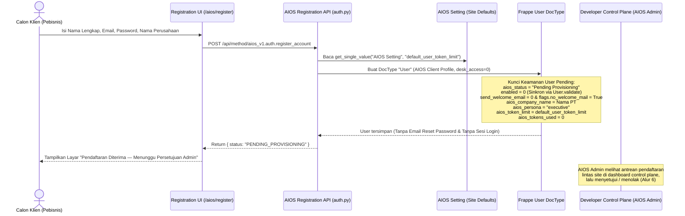
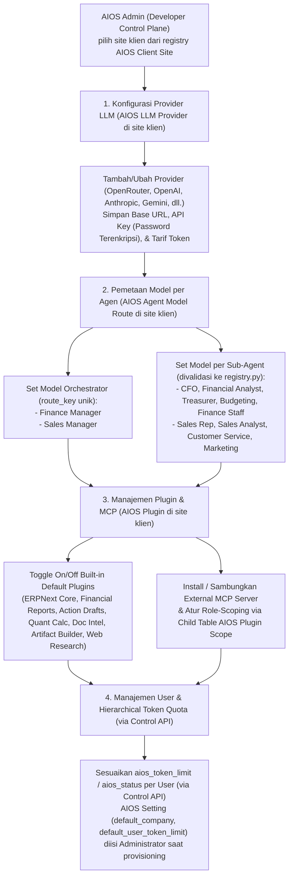
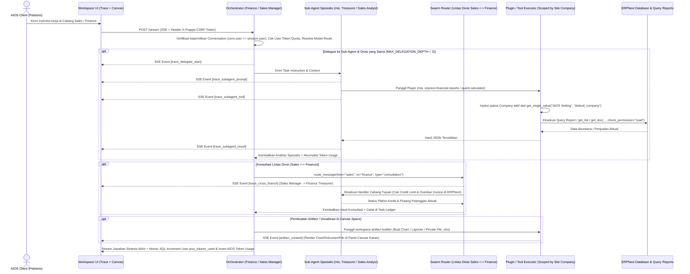
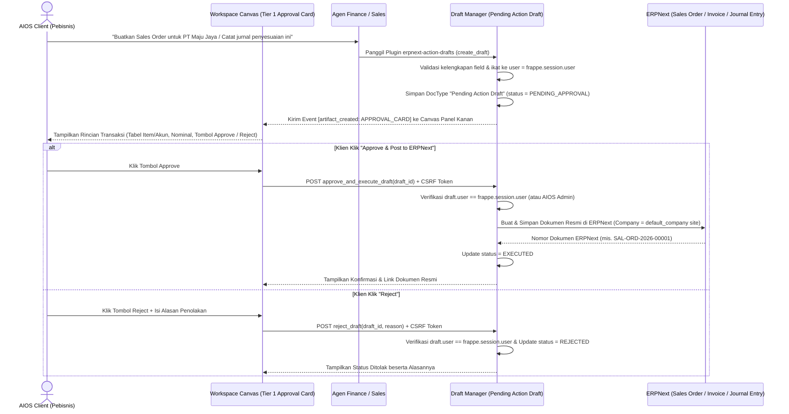
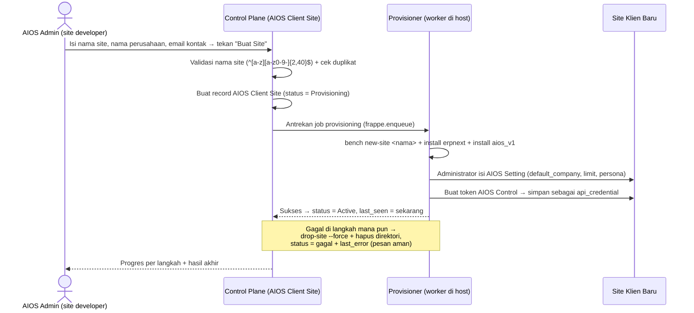
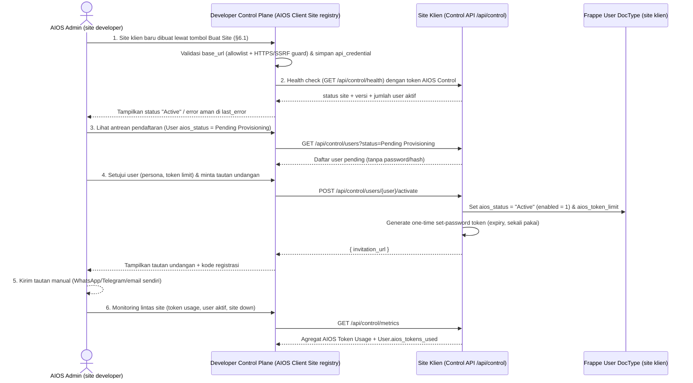

# 04 — Alur Kerja Sistem (End-to-End Workflows)

Dokumen ini menggambarkan 6 alur kerja utama di dalam AIOS V1 dari awal pendaftaran pengguna hingga eksekusi kolaborasi agen, persetujuan transaksi di ERPNext, dan pengelolaan lintas site dari Developer Control Plane. Setiap alur disajikan dalam bentuk diagram **Mermaid** sekaligus **rincian langkah teknis bernomor** agar mudah dibaca manusia maupun diproses oleh AI agent.

---

## Alur 1 — *Self-Service Registration* (`/aios/register` — *Pending Provisioning*) & Aktivasi User via Control Plane

Karena arsitektur multi-tenant AIOS V1 adalah **`1 Client = 1 Site`** (setiap perusahaan klien memiliki *instance site* dan database tersendiri), pendaftaran mandiri di halaman web tidak langsung membuat `Company` dadakan atau *auto-login* ke workspace, melainkan masuk ke status **`Pending Provisioning`** pada DocType `User` dengan `enabled = 0` dan tanpa pengiriman email *reset password* otomatis. **Aktivasi akun dan penerbitan undangan dilakukan oleh `AIOS Admin` dari Developer Control Plane** (Alur 6), bukan oleh operator di site klien.

### Rincian Langkah Alur 1:
1. **Input Registrasi Mandiri:** Calon klien mengisi Nama Lengkap, Email, Password, dan Nama Perusahaan/PT pada halaman `/aios/register`.
2. **Validasi & Proteksi Enumerasi:** Endpoint registrasi (`@frappe.whitelist(allow_guest=True)` + `@rate_limit`) memvalidasi input dan menerapkan respons seragam agar tidak dapat disalahgunakan untuk enumerasi email.
3. **Resolusi Kuota Default dari `AIOS Setting`:** Sistem membaca nilai `frappe.db.get_single_value("AIOS Setting", "default_user_token_limit")` (tanpa angka gaib hardcoded di kode Python).
4. **Pembuatan Akun `User` Terkunci (`Pending Provisioning`):**
   - Sistem membuat dokumen `User` bawaan Frappe dengan Role `AIOS Client` (`user_type = "Website User"`, `desk_access = 0`).
   - Mematikan pengiriman email sambutan/reset password bawaan Frappe (`user.send_welcome_email = 0` dan `user.flags.no_welcome_mail = True`) sehingga user yang belum di-provision tidak menerima link `/update-password`.
   - Mengisi Custom Field pada `User`:
     - `aios_status = "Pending Provisioning"` (yang secara otomatis menyetel `User.enabled = 0` di `User.validate` sehingga `/login` standar Frappe juga tertutup rapat).
     - `aios_company_name = company_name`
     - `aios_persona = "executive"`
     - `aios_token_limit = default_user_token_limit`
     - `aios_tokens_used = 0`
   - Sistem **tidak** membuat DocType `AIOS Tenant`, **tidak** membuat `Company` ERPNext secara paksa di dalam request tersebut, dan **tidak** melakukan *auto-login* (`login_as`) ke `/aios`.
5. **Tampilan Menunggu Persetujuan:** UI menampilkan informasi bahwa pendaftaran telah diterima dan menunggu persetujuan admin AIOS (dilihat `AIOS Admin` di Developer Control Plane, Alur 6).
6. **Aktivasi via Control Plane:** Setelah disetujui, `AIOS Admin` di control plane menetapkan `aios_persona` (`executive`, `finance`, `sales`) dan `aios_token_limit`, lalu Control API *site* klien menyetel `User.aios_status = "Active"` (yang otomatis mengaktifkan `User.enabled = 1`). Kredensial awal tidak pernah dikirim via email — pengguna diarahkan ke tautan set-password sekali pakai yang dikirim `AIOS Admin` secara manual (WhatsApp/Telegram/email sendiri), lihat Alur 6.

---

## Alur 2 — Konfigurasi Provider, Model Routing, Plugin, & Kuota `User` dari Control Plane

Operator (`AIOS Admin` di Developer Control Plane) mengatur mesin kecerdasan, kapabilitas tool, serta kuota pemakaian token secara terpusat lintas site. **UI-nya berada di control plane; data konfigurasinya tetap tersimpan di site klien masing-masing** (`AIOS LLM Provider`, `AIOS Agent Model Route`, `AIOS Plugin` di site klien) — control plane hanya menyimpan registry site + kredensial Control API (`docs/03` §1.4).

> **`AIOS Setting` bukan bagian dari alur ini.** `default_company`, `default_user_token_limit`, dan `company_context_persona` diisi `Administrator` sekali saat *site* disiapkan (`docs/03` §1.3). Control plane tidak membaca maupun menulisnya.

### Rincian Langkah Alur 2:
1. **Pendaftaran Provider LLM (`AIOS LLM Provider`):** `AIOS Admin` menambahkan satu atau beberapa provider LLM dari UI control plane (setelah memilih *site* klien dari registry), mengisi `base_url`, `api_key` (disimpan sebagai field `Password` terenkripsi Frappe pada `AIOS LLM Provider` di *site* klien), daftar model, serta tarif token per model.
2. **Pemetaan Model per Peran Agen (`AIOS Agent Model Route`):** `AIOS Admin` memilih provider dan model spesifik untuk masing-masing **Orchestrator** (`Finance Manager`, `Sales Manager`) maupun setiap **Sub-Agent** (`cfo`, `financial-analyst`, `treasurer`, `budgeting-staff`, `finance-staff`, `sales-representative`, `sales-data-analyst`, `customer-service`, `marketing-specialist`), dengan `route_key` unik dan validasi nama agen ke `registry.py`.
3. **Kontrak *Fail-Loudly* (Zero Default Hardcode):** Bila ada agen yang dipanggil tetapi belum memiliki rute model aktif di database *site* klien, sistem langsung menghentikan eksekusi secara eksplisit (`frappe.throw`), mencatat ke `Error Log`, dan tidak pernah jatuh ke model default hardcoded.
4. **Pengaturan Plugin & MCP (`AIOS Plugin`):** `AIOS Admin` mengaktifkan/menonaktifkan *Built-in Default Plugins* maupun menyambungkan server MCP eksternal, serta mengatur hak akses plugin per cabang/sub-agent (*Least Privilege*) — semuanya di *site* klien yang dipilih.
5. **Manajemen Kuota Token per `User`:** `AIOS Admin` memantau konsumsi token tiap pengguna (`User.aios_tokens_used` & log `AIOS Token Usage`), lalu menaikkan/menurunkan `User.aios_token_limit` atau mengubah `User.aios_status` (`Active` / `Suspended`) per individu — lewat endpoint Control API dengan token `AIOS Control`, bukan login Desk di site klien. Nilai kuota *default* site (`AIOS Setting.default_user_token_limit`) sudah diisi `Administrator` saat *site* disiapkan dan tidak diubah dari control plane.

---

## Alur 3 — Autentikasi Sesi, Guard 3 Lapis `aios_status`, Bootstrap CSRF, & Routing Peran

### Rincian Langkah Alur 3:
1. **Login Standar Frappe + Guard 3 Lapis (`enabled`, `on_login`, `auth_hooks`):**
   - `LoginManager.authenticate()` (`frappe/auth.py:286`) menolak user bila `enabled == 0`.
   - Hook `on_login` (`frappe/auth.py:172`, dijalankan sebelum `make_session()`) dan `auth_hooks` (`frappe/auth.py:750`, dijalankan di setiap request) memeriksa `frappe.db.get_value("User", user, "aios_status")` secara langsung dari DB (tanpa cache). Jika nilainya bukan `"Active"`, request langsung dihentikan dengan `frappe.AuthenticationError`.
2. **Penerbitan Cookie Sesi (`sid`):** Jika aktif, Frappe membuat sesi di Redis dan mengirimkan cookie `sid` (`HttpOnly`, `SameSite=Lax`).
3. **Bootstrap Sesi & Token CSRF (`get_session_context`):** Frontend memanggil endpoint `@frappe.whitelist()` `get_session_context()` yang mengeksekusi `frappe.sessions.get_csrf_token()` untuk men-generate token di Redis sekaligus mengembalikannya ke frontend bersama informasi `roles`, `aios_persona`, `aios_token_limit`, `aios_tokens_used`, dan `default_company` site.
4. **Pemisahan Peran Berbasis Role:**
   - Jika pengguna memiliki role `AIOS Admin` (hanya ada di *site developer*), aplikasi mengarahkan ke **Developer Control Plane**.
   - Jika pengguna memiliki role `AIOS Client`, aplikasi mengarahkan ke **Workspace Bisnis (Finance & Sales)**.
   - Role `AIOS Control` **tidak pernah login sebagai manusia**; ia hanya dipakai endpoint Control API dengan token layanan.
5. **Penegakan CSRF:** Seluruh request tulis (`POST`/`PUT`/`DELETE`) berikutnya dari frontend wajib menyertakan header `X-Frappe-CSRF-Token`.

---

## Alur 4 — Eksekusi Tugas, Delegasi Agen (*Live Agent Trace*), Kolaborasi Lintas Divisi, & Render *Artifact/Canvas*

Alur ini terjadi ketika pengguna klien meminta analisis atau pekerjaan lintas peran (misalnya meminta evaluasi pesanan pelanggan sekaligus analisis arus kas dan pembuatan laporan Excel/grafik).

### Rincian Langkah Alur 4:
1. **Verifikasi Awal Request (`/stream`):** Saat klien mengirim pesan, sistem memverifikasi kepemilikan `AIOS Conversation` terhadap `frappe.session.user` aktif, memastikan `User.aios_status == "Active"`, memeriksa sisa kuota token user (`User.aios_tokens_used < User.aios_token_limit`), dan mengambil konfigurasi model dari `AIOS Agent Model Route`.
2. **Perakitan Prompt Berlapis & Skema Plugin:** Sistem merakit System Prompt (`AIOS_ETHOS` + Identitas/SOP peran + `AIOS Setting.company_context_persona` + `User.aios_persona` + `User.aios_persona_context`) dan hanya menyertakan skema tool dari plugin yang aktif (`enabled = 1`) serta diizinkan untuk peran tersebut (di mana `orchestrator_delegate_to_subagent` hanya diberikan ke Orchestrator agar Sub-Agent tidak dapat mendelegasikan ulang tanpa batas).
3. **Delegasi Sub-Agent Nyata & 5 Event Kanonik *Live Agent Trace*:**
   - Bila Orchestrator memanggil `orchestrator_delegate_to_subagent`, backend mengirimkan event SSE kanonik (`trace_delegate_start`, `trace_subagent_prompt`, `trace_subagent_tool`, `trace_subagent_result`, `trace_cross_branch`) ke kolom kiri UI (**Live Agent Trace** tanpa emoji).
   - Sub-Agent yang ditunjuk benar-benar dieksekusi dengan model dan daftar tool spesifik miliknya.
4. **Injeksi Paksa Konteks `Company` Site-Level & Izin Baca ERPNext:**
   - Setiap kali Sub-Agent atau Orchestrator memanggil plugin (`erpnext-core-data`, `erpnext-financial-reports`, dll.), `execute_tool` mengabaikan klaim company dari argumen LLM dan menyuntikkan `allowed_company` yang dibaca secara site-level dari `frappe.db.get_single_value("AIOS Setting", "default_company") or frappe.db.get_single_value("Global Defaults", "default_company")`.
   - Pembacaan detail dokumen menggunakan `frappe.get_doc(doctype, name, check_permission="read")`.
   - Perhitungan angka finansial/statistik dilakukan secara deterministik melalui plugin `quant-calculator`.
5. **Kolaborasi Lintas Divisi (`Sales ↔ Finance`):**
   - Melalui `SwarmRouter(user=frappe.session.user)` (tanpa fallback default `1` dan tanpa fallback handler mock), divisi Sales berkonsultasi secara otonom ke divisi Finance untuk memeriksa plafon kredit dan piutang jatuh tempo di ERPNext sebelum pesanan baru dibuat.
6. **Pembuatan File & Visualisasi di *Artifact/Canvas Space*:**
   - File kerja (`.xlsx`, `.csv`, `.pdf`, `.md`) disimpan menggunakan DocType `File` Frappe (`is_private=1`, terikat ke `AIOS Conversation` milik user) dan sistem mengirim event `artifact_created` sehingga panel **Canvas** di sebelah kanan layar langsung merender hasilnya.
7. **Sintesis Jawaban & Akuntansi Token Atomik (`usage.py`):** Orchestrator menyusun jawaban akhir untuk pengguna, mencatat rincian ke DocType `AIOS Token Usage`, dan meng-update `User.aios_tokens_used` secara atomik menggunakan SQL (`SET aios_tokens_used = aios_tokens_used + %s`) tanpa memanggil `user_doc.save()`.

---

## Alur 5 — Aksi Tulis Bisnis & *Human-in-the-Loop Approval* (`Pending Action Draft`)

AIOS memegang prinsip keselamatan mutlak untuk data keuangan dan transaksi: **agen AI tidak pernah menulis atau mengubah dokumen transaksi langsung ke database ERPNext tanpa persetujuan eksplisit dari manusia.**

### Rincian Langkah Alur 5:
1. **Permintaan atau Rekomendasi Aksi Tulis:** Pengguna meminta pembuatan dokumen transaksi baru (mis. *Quotation*, *Sales Order*, *Sales Invoice*, *Payment Entry*, atau *Journal Entry*) atau agen mengusulkan tindak lanjut transaksi dari hasil analisis.
2. **Pembuatan `Pending Action Draft`:** Agen memanggil plugin `erpnext-action-drafts` yang memvalidasi struktur payload dan menyimpannya ke doctype `Pending Action Draft` dengan `status = "PENDING_APPROVAL"`, terikat ketat ke `user = frappe.session.user`, dan memiliki batas waktu kedaluwarsa (`expires_at`).
3. **Render *Tier 1 Interactive Approval Card* di Canvas:** Panel Canvas di sebelah kanan ruang chat menampilkan kartu persetujuan berisi tabel rincian item/akun, nominal, justifikasi bisnis, serta tombol aksi **Approve & Post to ERPNext** dan **Reject**.
4. **Eksekusi Saat Disetujui (**Approve**):**
   - Pengguna menekan tombol **Approve**.
   - Backend (`approve_and_execute_draft`) memverifikasi autentikasi sesi, token CSRF, dan memastikan `draft.user == frappe.session.user` (atau user memiliki role `AIOS Admin`).
   - Sistem membuat dokumen resmi di ERPNext di bawah `Company` aktif pada site tersebut, mengubah status draf menjadi `EXECUTED`, dan mengembalikan nomor dokumen resmi ERPNext ke layar pengguna.
5. **Pembatalan Saat Ditolak (**Reject**):**
   - Bila pengguna menekan **Reject** dan mengisi alasan penolakan, sistem memverifikasi kepemilikan draf, memperbarui status draf menjadi `REJECTED`, dan menyimpan alasan penolakan ke field `rejection_reason` tanpa menyentuh database transaksi ERPNext.

### Jenis Aksi & Batas Wewenang (mengikat)

`Pending Action Draft` wajib menyimpan **jenis aksi**, bukan hanya payload dokumen:

| Jenis aksi | Kapan dipakai | Efek setelah Approve |
|---|---|---|
| `CREATE` | Membuat dokumen baru | Dokumen dibuat & di-submit di ERPNext |
| `UPDATE_DRAFT` | Mengubah `Pending Action Draft` milik agen yang belum disetujui | Payload draf diperbarui; belum ada yang ditulis ke ERPNext |
| `CANCEL_AND_AMEND` | Mengoreksi dokumen yang sudah `docstatus = 1` | Dokumen lama di-cancel (jurnal pembalik), draft baru bernilai benar dibuat & di-submit |

**Batas yang tidak boleh dilanggar agen:**
1. **Agen tidak pernah menulis langsung ke tabel ERPNext — termasuk untuk draft.** Semua aksi tulis agen berhenti di `Pending Action Draft`; dokumen ERPNext baru dibuat saat manusia menekan **Approve**.
2. **Dokumen `submitted` (`docstatus = 1`) tidak pernah diedit atau dihapus.** ERPNext sendiri menolak; koreksi hanya lewat `CANCEL_AND_AMEND`.
3. **Agen tidak pernah men-submit sendiri.** Submission hanya terjadi setelah manusia menekan **Approve**.
4. **Approval card wajib menampilkan nilai sebelum → sesudah** (field yang berubah, nominal lama vs baru) — bukan hanya ringkasan "perbaiki dokumen ini".
5. **Tidak ada penghapusan permanen** pada dokumen bisnis. Yang ada hanya pembatalan (`Cancelled`) yang menyisakan jejak.

### Alur Koreksi Data yang Sudah Masuk

1. Pengguna memberi tahu ada data salah (mis. invoice tercatat 1.000, seharusnya 100).
2. Agen membaca dokumen dan memeriksa `docstatus`.
3. Bila `docstatus = 0` → agen menyusun `UPDATE_DRAFT`.
4. Bila `docstatus = 1` → agen menyusun `CANCEL_AND_AMEND`; ERPNext membuat jurnal pembalik dan draft baru tertaut `amended_from`.
5. Manusia meninjau approval card (sebelum → sesudah), lalu Approve atau Reject.
6. Setelah Approve, dokumen lama tetap ada berstatus `Cancelled` dan tertaut ke dokumen pengganti.
7. Bila koreksi menyentuh periode tutup buku, agen **tidak** mengusulkan cancel; ia mengusulkan jurnal koreksi di periode berjalan dan menandai bahwa keputusan akhir ada di akuntan.

---

## Alur 6 — Provisioning Klien Lintas Site & Monitoring dari Developer Control Plane

`AIOS Admin` mengelola banyak klien dari satu dashboard di *site developer*. Setiap *site* klien tetap menjadi *data plane* mandiri; control plane tidak menyimpan data bisnis klien dan tidak pernah memakai `Administrator`.

### 6.1. Membuat Site Klien Baru (tombol **Buat Site** — Fase 2 `#11`)

**Aturan provisioning otomatis:**
1. **Nama site divalidasi ketat** `^[a-z][a-z0-9-]{2,40}$` — mencegah penyusupan argumen.
2. **Perintah dijalankan sebagai daftar argumen** (`subprocess.run([...])`), bukan string gabungan, dan tanpa `shell=True`.
3. **Hanya `AIOS Admin` di site developer** yang boleh memicu; setiap pemanggilan dicatat (siapa, nama site, hasil).
4. **Gagal di tengah wajib dibersihkan** — `bench drop-site --force` + hapus direktori, supaya tidak ada site setengah jadi.
5. **Alamat site memakai hostname, bukan port:** `nama.localhost` di lokal, `nama.<IP-server>.nip.io` di server testing. Tanpa domain, tanpa sertifikat, tanpa konfigurasi nginx per site.
6. **`Administrator` hanya dipakai di dalam job provisioning** untuk mengisi `AIOS Setting`; setelah selesai, jalur harian memakai `AIOS Control`.

### Rincian Langkah Alur 6:
1. **Registrasi Site Klien (`AIOS Client Site`, hanya di site developer):** record registry dibuat oleh alur provisioning (§6.1) berisi `site_name`, `base_url`, `company_name`, `contact_name`, `contact_email`, dan `api_credential` (field `Password` terenkripsi, di-mask di setiap log/error). Control plane memvalidasi `base_url` terhadap allowlist + wajib HTTPS (kecuali lokal) dengan guard anti-SSRF yang sama seperti `web-market-research`.
2. **Health Check & Status Site:** Control plane memanggil `GET /api/control/health` dengan token `AIOS Control`; hasilnya memperbarui `status`, `last_seen`, dan `last_error` (pesan aman, tanpa traceback/detail internal). Kegagalan tidak boleh dilaporkan sebagai sukses.
3. **Antrean Pendaftaran Lintas Site:** Control plane membaca `User` dengan `aios_status = "Pending Provisioning"` dari tiap site klien via Control API. Respons memuat **nama dan email** (diperlukan untuk undangan), **tidak pernah** memuat password, hash, API key, isi `AIOS Setting`, atau data bisnis.
4. **Persetujuan & Undangan:** Saat disetujui, Control API menyetel `aios_status = "Active"` (otomatis `enabled = 1`), `aios_persona`, dan `aios_token_limit`, lalu membuat token set-password **sekali pakai + kedaluwarsa** yang diproses di site klien. Password tidak pernah dikirim via email; control plane hanya menampilkan tautan undangan untuk dikirim manual oleh `AIOS Admin`.
5. **Pengiriman Undangan:** Untuk PoC tidak ada ketergantungan SMTP. `AIOS Admin` menyalin tautan undangan (dan kode registrasi) lalu mengirimkannya lewat kanal yang sudah dipakai (WhatsApp/Telegram/email sendiri). Integrasi email otomatis (Email Queue Frappe → SMTP/Email Account) menyusul tanpa mengubah kontrak tautan.
6. **Monitoring Lintas Site:** Control plane menarik agregat (`AIOS Token Usage`, `User.aios_tokens_used`, jumlah user aktif, status site) lewat `GET /api/control/metrics`. Data mentah tetap di site klien; control plane hanya menyimpan ringkasan yang diperlukan dashboard.
7. **Audit & Pemisahan Wewenang:** Setiap panggilan Control API dicatat (user pelaku, site target, operasi, hasil). `AIOS Control` hanya boleh operasi lifecycle & agregat monitoring — bukan menulis dokumen bisnis ERPNext. `Administrator` di site klien tidak pernah dipakai jalur ini.
