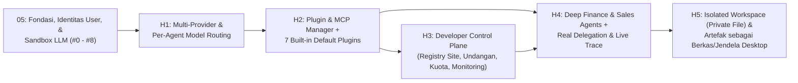

# 06 — Roadmap Pengembangan Business AI Harness (Bagian dari Target PoC)

**Status:** detail tahap H1–H5. **H1 ditunda** untuk PoC; **H2–H5 wajib PoC**. H3 = `#11`; H4 = pendalaman `#8`. Lihat **[00 — Target PoC](./00-poc-target.md)**.
**Prasyarat:** fondasi `docs/05.1` (`#13`, `#4a-1`, `#4a-2`, `#7b`, `#4d`, `#8`) selesai; H1 tidak dipakai di PoC.
**Basis:** arsitektur `docs/02`; skema `docs/03`; alur `docs/04`. Dokumen ini detail tahap + test, bukan definisi target PoC.

> **Prinsip Utama:**
> 1. **Setiap tahap wajib memiliki script test otomatis** (`unittest.TestCase` / `frappe.tests.IntegrationTestCase` dengan entitas dummy `_Test ...` dan guard `monkeypatch` pada `frappe.db.commit`).
> 2. **Zero Silent Error:** Setiap blok `except` wajib mencatat stack trace ke doctype `Error Log` (`frappe.log_error(title=..., message=frappe.get_traceback())`) dan/atau `raise`.
> 3. **Zero Hardcode:** Tidak boleh ada nama model LLM, URL provider, nama `Company` ERPNext, mata uang, kuota default, atau daftar tool aktif yang di-hardcode di kode Python. Bila konfigurasi belum tersedia di DB, sistem wajib gagal secara eksplisit (*fail loudly*).
> 4. **Arsitektur `1 Client = 1 Site` & Tanpa `AIOS Tenant`:** Seluruh atribut pengguna & kuota melekat pada DocType `User` (sudah didaftarkan di `#4b` via `create_custom_fields` + `frappe.db.updatedb("User")` di `after_install` dan `after_migrate` pada `hooks.py`), sedangkan nilai default tingkat site disimpan di `AIOS Setting`.
> 5. **Zero Emoji di UI:** Seluruh indikator visual di aplikasi menggunakan ikon vektor garis (Lucide/Geist) dan badge tipografi bersih (9 emoji lama di `frontend/lib/branches.ts` sudah dibersihkan di `#3`).

---

## Peta Urutan Pengembangan Harness (`H1` – `H5`)

> **Alur PoC:** fondasi (`#13`–`#8`) → **H2 → H4 → H5**; **H3/`#11` paralel**; **H1 ditunda**. Diagram di atas adalah jalur lengkap, bukan urutan PoC.

---

## Tahap H1 — `feat/multi-provider-model-routing` · ⏸ DITUNDA (PoC single model)

> **Jangan dikerjakan untuk PoC.** PoC memakai satu model dari `AIOS Setting`; H1 masuk fase setelah PoC.

> **Koreksi kepemilikan (2026-10-23):** konfigurasi model bersifat **global lintas semua site klien**; sumber kebenaran di site developer, disalin ke tiap site klien lewat Control API. Field `user` pada `AIOS Agent Model Route` dan lookup per-user di §1–§2 **tidak dipakai**; `route_key` cukup `f"{branch_key}:{agent_key}:*"`.

Menggantikan `AIOS Setting` lama (yang hanya mendukung 1 `base_url` dan 1 `model_name` untuk seluruh sistem) menjadi arsitektur konfigurasi **Multi-Provider & Per-Agent Model Routing** setara `opencode.jsonc`, tetapi dikelola penuh melalui UI oleh `AIOS Admin`.

### 1. Perubahan Skema DocType

Basis skema & field: `docs/02` §1.1. Delta H1:

1. **`AIOS LLM Provider`:** field mengikuti `docs/02` §1.1, ditambah `enabled` (`Check`, default `1`) dan `available_models_json` (`Code`/Child Table: model + `input_cost_per_1m` & `output_cost_per_1m`).
2. **`AIOS Agent Model Route`:** `route_key` unik (format `f"{branch_key}:{agent_key}:*"`), `branch_key` (`finance`/`sales`/`global`), `agent_key` (wajib validasi ke `registry.py`), `provider` (`Link -> AIOS LLM Provider`), `model_name`, `temperature` (default `DEFAULT_TEMPERATURE` di `lib/pricing.py`), `max_tokens` (default `AIOS Setting.default_max_tokens`). Field `user` **tidak dipakai** — konfigurasi global.
3. **Pembersihan field lama di `AIOS Setting`:** hapus `base_url`, `api_key`, `model_name` agar hanya ada satu sumber routing.

### 2. Perubahan Backend & UI
- **`aios_v1/lib/llm_client.py`:**
  - Fungsi `get_llm_config(branch_key: str, agent_key: str)` membaca rute global `f"{branch_key}:{agent_key}:*"` dari site developer; tidak ada lookup per user.
  - **Fail Loudly:** Jika rute model untuk `(branch_key, agent_key)` belum diatur atau provider-nya `enabled = 0`, panggil `frappe.log_error` dan `frappe.throw(f"Model LLM untuk agen {branch_key}/{agent_key} belum dikonfigurasi oleh AIOS Admin.")` — **dilarang keras** memberi fallback model default di kode Python.
- **UI di Developer Control Plane (sumber data di site developer):**
  - Halaman **LLM Providers & Agent Model Routing** di control plane (berlaku untuk semua site klien): tambah/edit/hapus provider, uji koneksi API Key, dan dropdown pemetaan model untuk setiap Orchestrator serta Sub-Agent. Perubahan disalin ke tiap site klien lewat Control API (`AIOS Control`), bukan login Desk di site klien.

### 3. Script Test Wajib
- `aios_v1/tests/test_agent_model_routing.py`:
  - Uji resolusi dinamis model berbeda antara Orchestrator (`finance/manager`) dan Sub-Agent (`finance/treasurer`), serta keunikan `route_key` dan penolakan `agent_key` yang tidak terdaftar di `registry.py`.
  - Uji *fail-loudly* (`frappe.ValidationError`) ketika agen dipanggil saat rute model kosong atau provider dinonaktifkan.

---

## Tahap H2 — `feat/plugin-mcp-manager` · WAJIB PoC

> **Wajib PoC.** Tanpa H2 agent cuma punya 3 plugin ERPNext dari `#8`; H2 melengkapi 7 plugin + scope.

> **Lokasi data (2026-10-23):** `AIOS Plugin` dan `AIOS Plugin Scope` ada di **site developer** sebagai sumber kebenaran, disalin ke tiap site klien untuk dipakai runtime. Konfigurasi ini global — tidak ada plugin per site.

Merombak `aios_v1/lib/tool_registry.py` menjadi **Plugin & MCP Manager** di atas fondasi plugin awal dari `#8` (`erpnext-core-data` & `erpnext-financial-reports`), melengkapinya menjadi 7 *Built-in Default Plugins*, dapat di-*toggle* On/Off melalui UI `AIOS Admin`, serta mendukung server MCP eksternal. Tiga plugin ERPNext adalah **wrapper tipis** di atas API ERPNext; skema tool-nya diadaptasi dari `@casys/mcp-erpnext` (MIT) — lihat `docs/02` §2.2.

### 1. Skema DocType `AIOS Plugin` & Child Table `AIOS Plugin Scope` (Hanya `AIOS Admin`)
- **`AIOS Plugin`:**
  - `plugin_key` (`Data`, Unique)
  - `plugin_name` (`Data`, Mandatory)
  - `plugin_type` (`Select`: `BUILT_IN`, `EXTERNAL_MCP_HTTP`, `EXTERNAL_MCP_SSE`)
  - `enabled` (`Check`, default `1`)
  - `scopes` (`Table -> AIOS Plugin Scope`: berisi `scope_type` (`branch` / `worker`), `scope_key`, dan `enabled` — menggantikan string bebas agar tervalidasi ke `registry.py`)
  - `endpoint_url` / `config_json` (`Data` / `Code` untuk plugin MCP eksternal)

### 2. Katalog Lengkap 7 *Built-in Default Plugins*
Katalog, fungsi, dan primitif 7 plugin mengikuti `docs/02` §2.2. Delta H2: plugin yang fondasinya dibuat di `#8` (`erpnext-core-data`, `erpnext-financial-reports`, `erpnext-action-drafts`) didaftarkan ke `AIOS Plugin`; `AIOS Plugin Scope` membatasi akses per branch/worker; plugin eksternal MCP mengikuti §1.

### 3. UI di Developer Control Plane (sumber data di site developer)
- Halaman **Plugin & MCP Registry** di control plane (berlaku untuk semua site klien): daftar seluruh plugin bawaan dan eksternal, tombol toggle **On/Off**, tombol *Discover Tools / Health Check* untuk MCP eksternal, serta pengaturan izin akses (`AIOS Plugin Scope`) per cabang/sub-agent. Perubahan disalin ke tiap site klien lewat Control API.

### 4. Script Test Wajib
- `aios_v1/tests/test_plugin_manager.py`:
  - Uji penonaktifan plugin (`enabled = 0`) otomatis menghapus skema tool tersebut dari `get_tools_schema_for_worker()` dan menolak `execute_tool()`.
  - Uji `AIOS Client` berhasil mengeksekusi `erpnext-core-data` dan `erpnext-financial-reports` (`read=1, report=1`) tanpa `PermissionError`, serta menolak akses lintas `Company`.
  - Uji guard anti-SSRF pada `web-market-research` (menolak `127.0.0.1`, `169.254.169.254`, dan IP privat).

---

## Tahap H3 — `feat/developer-control-plane` · WAJIB PoC (= `#11`)

> **Ini sama dengan `#11`.** Jangan dikerjakan dua kali; kontrak & acceptance ada di `docs/05.1` #11.

Membangun **Developer Control Plane**: satu *site* Frappe khusus developer yang menjalankan dashboard `AIOS Admin` untuk mengelola **banyak site klien lintas site** — registri site, persetujuan pendaftaran, undangan sekali pakai, kuota, dan monitoring agregat. Kontrak normatif: `docs/03` §1.4 dan `docs/04` Alur 6. Tahap ini **tidak menduplikasi** pembuatan Custom Field, `usage.py`, atau alur approval; ia hanya memakai ulang fondasi `#4b`, `#5`, `#7b`, dan `#8`.

**Dibagi dua fase:** §1–§3 = **Fase 1** (dashboard operasional), §4 = **Fase 2** (tombol **Buat Site**). Fase 2 dikerjakan setelah Fase 1 dan tidak boleh memblokir `#8`.

### 1. Registri Site Klien (`AIOS Client Site`, hanya di site developer)
1. Field mengikuti `docs/03` §1.4: `site_name` (unique), `base_url`, `company_name`, `contact_name`, `contact_email`, `api_credential` (`Password`), `status`, `last_seen`, `last_error`, `notes`.
2. **Tanpa `plan`/billing/tiering.** Kuota PoC = satu gerbang site (`AIOS Setting.site_token_limit`); `User.aios_tokens_used` statistik; registry opsional.
3. Validasi `base_url`: allowlist + wajib HTTPS di non-lokal, guard SSRF (RFC1918/loopback/link-local/cloud metadata, re-check redirect).

### 2. Role `AIOS Control` & Control API di Site Klien
1. Role layanan tanpa login manusia: **`read` pada `User` dan `AIOS Token Usage` saja**. Tidak ada akses `AIOS Setting`, tidak ada akses DocType bisnis/ERPNext.
2. Tulis lifecycle (`aios_status`) lewat endpoint khusus yang hanya menyentuh field itu via `frappe.db.set_value` — **bukan `DocPerm write` pada `User`** (yang akan membuka password/role/`enabled`).
3. Endpoint `/api/control/health`, `/users`, `/users/{user}/activate`, `/metrics`: validasi token `api_credential`, tolak sesi manusia, audit tiap panggilan, mask token di semua error/log. `/metrics` mengembalikan angka agregat saja, bukan isi dokumen.
4. `AIOS Admin` **tidak dipasang di site klien**; `Administrator` tidak pernah dipakai jalur ini.

### 3. Dashboard Control Plane (UI `AIOS Admin`)
1. **Daftar Site & Kesehatan:** status, `last_seen`, `last_error`, aksi health check manual.
2. **Antrean `Pending Provisioning` Lintas Site:** daftar user pending per site, aksi setujui/tolak, set `aios_persona`.
3. **Undangan Sekali Pakai:** token set-password dibuat & divalidasi **di site klien** (expiry + sekali pakai); dashboard hanya menampilkan tautan + kode registrasi untuk dikirim manual. **Tanpa SMTP untuk PoC**; email otomatis menyusul lewat Email Queue Frappe tanpa mengubah kontrak tautan.
4. **Monitoring Agregat:** token usage per site/user/cabang/model, jumlah user aktif, site down.

### 4. Tombol "Buat Site" (provisioning otomatis)
1. Form: nama site, nama perusahaan, email kontak → tombol **Buat Site**.
2. Validasi nama site `^[a-z][a-z0-9-]{2,40}$` + cek duplikat; perintah dijalankan sebagai daftar argumen tanpa `shell=True`.
3. Job `frappe.enqueue` di host: `bench new-site` → `install-app erpnext` → `install-app aios_v1` → `Administrator` isi `AIOS Setting` → buat token `AIOS Control`.
4. Gagal di tengah → `bench drop-site --force` + hapus direktori; `status = gagal`, `last_error` pesan aman. Tidak boleh ada site setengah jadi.
5. Progres per langkah di dashboard. Alamat memakai hostname (`nama.localhost` / `nama.<IP>.nip.io`), tanpa domain/sertifikat/nginx per site.

### 5. Script Test Wajib
- `aios_v1/tests/test_control_api_auth.py`: token salah/kosong → 401 + tercatat; sesi manusia ditolak; token tidak muncul di pesan error/log.
- `aios_v1/tests/test_control_site_registry.py`: `site_name` unik, `base_url` non-allowlist ditolak.
- `aios_v1/tests/test_control_ssrf_guard.py`: menolak `127.0.0.1`, `169.254.169.254`, IP privat, dan redirect ke host terlarang.
- `aios_v1/tests/test_control_lifecycle.py`: setujui user pending → `aios_status = "Active"` + `enabled = 1`; `AIOS Control` tidak bisa membaca `AIOS Setting` maupun dokumen bisnis; `Administrator` tidak tersentuh.
- `aios_v1/tests/test_site_provisioning.py`: satu penekanan tombol menghasilkan site baru yang bisa dibuka; nama site tidak valid (huruf besar, spasi, `..`, `;`) ditolak.
- `aios_v1/tests/test_site_provisioning_cleanup.py`: kegagalan di tengah job tidak meninggalkan site/database setengah jadi.

---

## Tahap H4 — `feat/deep-finance-sales-agents` · WAJIB PoC (= pendalaman `#8`)

> **Ini pendalaman `#8`.** `#8` menyiapkan tool dasar; H4 memperdalam delegasi, trace, dan akumulasi token.

Merombak total perilaku agen di cabang **Finance** dan **Sales** dari sekadar prompt statis menjadi organisasi agen yang dapat melakukan **delegasi nyata** dan **konsultasi lintas cabang** dengan transparansi visual di UI (*Live Agent Trace*).

### 1. Perombakan Sub-Agents, Batas Rekursi, & Orkestrasi (`Finance` & `Sales`)
- Fokuskan `registry.py` pada 2 cabang utama (`finance` dan `sales`); nonaktifkan sementara (`enabled = False`) 7 cabang lainnya dan sembunyikan fitur Telegram (`dormant`).
- **Pencegahan Rekursi Tak Terbatas (`MAX_DELEGATION_DEPTH = 2`):**
  - Di `get_tools_schema_for_worker()` (`tool_registry.py`), pastikan tool `orchestrator_delegate_to_subagent` **hanya diberikan kepada Orchestrator (`worker_key == "manager"`)** dan tidak pernah diberikan ke Sub-Agent sehingga Sub-Agent tidak dapat mendelegasikan ulang ke Sub-Agent lain.
- **Hapus Seluruh Kode Return Dummy/Mock di `ai_manager_tools.py` & `swarm_router.py`:**
  - `orchestrator_delegate_to_subagent(branch, worker_key, task_instruction, context_data)` benar-benar memanggil eksekusi LLM Sub-Agent tujuan menggunakan model dari `AIOS Agent Model Route` beserta plugin/tool milik Sub-Agent tersebut.
  - Ubah konstruktor `SwarmRouter(user: str)` dan `TaskLedger`/`SafetyGuard` agar wajib menerima `user` (hapus default `tenant_id: int = 1`), daftarkan handler nyata untuk cabang `finance` dan `sales`, dan **hapus fallback handler mock** di `swarm_router.py:97-104` (jika handler cabang tidak terdaftar, wajib `frappe.log_error` + `frappe.throw`).
- **Kontrak Tunggal 5 Event SSE *Live Agent Trace* (`aios_v1/shared/trace_events.py`):**
  - Nama & makna event mengikuti `docs/02` §3.1; tata letak tampilan mengikuti `docs/08` §3. Payload kanonik di modul konstanta:
    1. `trace_delegate_start`: `{"type": "trace_delegate_start", "from": ..., "to": ..., "instruction": ...}`
    2. `trace_subagent_prompt`: `{"type": "trace_subagent_prompt", "agent": ..., "system_prompt_summary": ..., "task_prompt": ...}`
    3. `trace_subagent_tool`: `{"type": "trace_subagent_tool", "agent": ..., "tool": ..., "args": ...}`
    4. `trace_subagent_result`: `{"type": "trace_subagent_result", "agent": ..., "summary": ..., "usage": ...}`
    5. `trace_cross_branch`: `{"type": "trace_cross_branch", "from_branch": ..., "to_branch": ..., "payload": ..., "result": ...}`
  - Akumulasikan seluruh `usage` token dari Orchestrator + semua Sub-Agent yang terlibat secara atomik melalui `aios_v1/services/usage.py` (yang sudah dibuat di `#7`).

### 2. UI *Live Agent Trace* (Zero Emoji)
- Render komponen **Agent Delegation Trace Drawer / Collapsible Step Card** menggunakan ikon vektor garis dan badge tipografi (`DELEGATE`, `PROMPT`, `CROSS-BRANCH`, `TOOL`, `RESULT`).
- Pengguna dapat membuka kartu trace untuk membaca prompt instruksi Orchestrator ke Sub-Agent (`trace_subagent_prompt`), tool yang dieksekusi, dan jawaban Sub-Agent.

### 3. Script Test Wajib
- `aios_v1/tests/test_subagent_delegation_real.py`:
  - Uji pemanggilan `orchestrator_delegate_to_subagent` benar-benar mengeksekusi loop Sub-Agent, memancarkan ke-5 event SSE kanonik (termasuk `trace_subagent_prompt`), menolak delegasi bertingkat dari Sub-Agent (`MAX_DELEGATION_DEPTH`), dan mengakumulasikan token usage secara atomik ke `User.aios_tokens_used`.
- `aios_v1/tests/test_cross_branch_sales_finance.py`:
  - Uji skenario *Order-to-Cash*: Sales Manager memanggil `cross_branch_consultation` ke Finance untuk memeriksa piutang pelanggan sebelum menyusun draf *Sales Order*, serta uji *fail-loudly* bila cabang tujuan tidak memiliki handler.

---

## Tahap H5 — `feat/isolated-workspace-and-artifacts` · WAJIB PoC (sandbox file/workspace)

> **Wajib PoC.** Ini sandbox file/workspace agent, bukan sekadar demo artefak. Tanpa H5 agent tidak punya batas file yang jelas.

Menyediakan ruang kerja file terisolasi (*Isolated Workspace*) per sesi percakapan menggunakan primitif Private `File` Frappe, dengan artefak tampil sebagai **berkas dan jendela di desktop** (`docs/08` §5).

### 1. Isolated Workspace Backend (Berbasis Frappe Private `File` DocType)
- Gunakan `frappe.core.doctype.file.utils.save_file(..., is_private=1, dt="AIOS Conversation", dn=conversation_id)` sehingga setiap file kerja (`.xlsx`, `.csv`, `.pdf`, `.md`) tercatat resmi di DocType `File` dengan kepemilikan `owner = frappe.session.user` dan dilindungi oleh `File.validate_file_access` + `has_permission` pada `AIOS Conversation`.
- Tambahkan guard validasi nama file (*filename sanitization* & blokir `..` / path separator) sebelum memanggil `save_file`.

### 2. Implementasi Artefak Desktop
Jenis artefak mengikuti `docs/02` §3.2; bentuk tampilan mengikuti `docs/08` §5. Delta implementasi H5:
- Artefak dibuka sebagai berkas/jendela desktop berdasarkan event SSE `{"type": "artifact_created", "artifact": {...}}` (`docs/08` §5).
- Tier 1 approval card memanggil alur approve/reject di `docs/04` Alur 5; Tier 5 dirender dalam iframe `sandbox="allow-same-origin"` tanpa script eksternal.

### 3. Script Test Wajib
- `aios_v1/tests/test_workspace_isolation.py`:
  - Uji pembuatan Private `File` `.xlsx` / `.csv` / `.md` yang terikat ke `AIOS Conversation` User A; pastikan usaha akses oleh User B atau usaha injeksi nama file (`../../`) ditolak keras (`403` / `ValidationError`).
- `aios_v1/tests/test_artifact_draft_to_erpnext.py`:
  - Uji siklus penuh: agen membuat `Pending Action Draft` *Sales Order* pada Company dummy `_Test Company AIOS` → pengguna menekan Approve → dokumen `Sales Order` resmi terbentuk di ERPNext dengan nilai yang persis sama.
