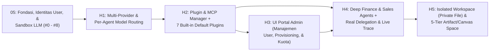

# 06 — Roadmap Pengembangan Business AI Harness (Fase Lanjutan Setelah Fondasi)

**Status:** Spesifikasi & Rencana Eksekusi Fase 2 (Tanpa Duplikasi dengan Fase 1)
**Prasyarat Wajib:** Fondasi Keamanan, Identitas `User`, & Higienitas di **[`05-roadmap-perbaikan-fondasi.md`](./05-roadmap-perbaikan-fondasi.md)** (`#0`, `#1`, `#2`, `#3`, `#4a–#4d`, `#5`, dan `#7`) selesai lebih dulu.

> **Prinsip Utama:**
> 1. **Setiap tahap wajib memiliki script test otomatis** (`unittest.TestCase` / `frappe.tests.IntegrationTestCase` dengan entitas dummy `_Test ...` dan guard `monkeypatch` pada `frappe.db.commit`).
> 2. **Zero Silent Error:** Setiap blok `except` wajib mencatat stack trace ke doctype `Error Log` (`frappe.log_error(title=..., message=frappe.get_traceback())`) dan/atau `raise`.
> 3. **Zero Hardcode:** Tidak boleh ada nama model LLM, URL provider, nama `Company` ERPNext, mata uang, kuota default, atau daftar tool aktif yang di-hardcode di kode Python. Bila konfigurasi belum tersedia di DB, sistem wajib gagal secara eksplisit (*fail loudly*).
> 4. **Arsitektur `1 Client = 1 Site` & Tanpa `AIOS Tenant`:** Seluruh atribut pengguna & kuota melekat pada DocType `User` (sudah didaftarkan di `#4b` via `create_custom_fields` + `frappe.db.updatedb("User")` di `after_install` dan `after_migrate` pada `hooks.py`), sedangkan nilai default tingkat site disimpan di `AIOS Setting`.
> 5. **Zero Emoji di UI:** Seluruh indikator visual di aplikasi menggunakan ikon vektor garis (Lucide/Geist) dan badge tipografi bersih (9 emoji lama di `frontend/lib/branches.ts` sudah dibersihkan di `#3`).

---

## Peta Urutan Pengembangan Harness (`H1` – `H5`)

---

## Tahap H1 — `feat/multi-provider-model-routing`

Menggantikan `AIOS Setting` lama (yang hanya mendukung 1 `base_url` dan 1 `model_name` untuk seluruh sistem) menjadi arsitektur konfigurasi **Multi-Provider & Per-Agent Model Routing** setara `opencode.jsonc`, tetapi dikelola penuh melalui UI oleh `AIOS Admin`.

### 1. Perubahan Skema DocType
1. **`AIOS LLM Provider` (DocType Baru — Hanya `AIOS Admin`):**
   - `provider_name` (`Data`, Unique, mis. `OpenRouter`, `Anthropic`, `OpenAI`, `Google Gemini`, `Local vLLM`)
   - `enabled` (`Check`, default `1`)
   - `base_url` (`Data`, Mandatory)
   - `api_key` (`Password`, Mandatory — dienkripsi Frappe; memisahkan kredensial rahasia dari `AIOS Setting`)
   - `available_models_json` (`Code` / Child Table daftar model beserta `input_cost_per_1m` & `output_cost_per_1m`)
2. **`AIOS Agent Model Route` (DocType — Hanya `AIOS Admin`):**
   - `route_key` (`Data`, **Unique**, Mandatory — di-generate otomatis di `validate()` dengan format `f"{branch_key}:{agent_key}:{user or '*'}"` untuk mencegah duplikasi rute)
   - `branch_key` (`Data`, Mandatory: `finance`, `sales`, `global`)
   - `agent_key` (`Data`, Mandatory: `manager` untuk Orchestrator, atau key sub-agent seperti `cfo`, `financial-analyst`, `treasurer`, `budgeting-staff`, `finance-staff`, `sales-representative`, `sales-data-analyst`, `customer-service`, `marketing-specialist` — **wajib divalidasi terhadap `registry.py` saat `validate()`** agar salah ketik langsung ditolak)
   - `provider` (`Link -> AIOS LLM Provider`, Mandatory)
   - `model_name` (`Data`, Mandatory)
   - `temperature` (`Float`, Nullable — jika kosong mengacu ke konstanta bernama `DEFAULT_TEMPERATURE` di `lib/pricing.py`)
   - `max_tokens` (`Int`, Nullable — jika kosong mengacu ke `AIOS Setting.default_max_tokens`)
   - `user` (`Link -> User`, Optional — dikosongkan untuk konfigurasi Global Site oleh `AIOS Admin`; jika diisi, resolver memprioritaskan rute spesifik user sebelum jatuh ke rute global `*`)
3. **Pembersihan Field Lama di `AIOS Setting`:**
   - Hapus field legacy `base_url`, `api_key`, dan `model_name` dari `aios_setting.json` di branch yang sama agar hanya ada satu sumber kebenaran routing model.

### 2. Perubahan Backend & UI
- **`aios_v1/lib/llm_client.py`:**
  - Fungsi `get_llm_config(branch_key: str, agent_key: str, user_id: str | None = None)` mencari rute spesifik `f"{branch_key}:{agent_key}:{user_id}"` lalu fallback ke rute global site `f"{branch_key}:{agent_key}:*"`.
  - **Fail Loudly:** Jika rute model untuk `(branch_key, agent_key)` belum diatur atau provider-nya `enabled = 0`, panggil `frappe.log_error` dan `frappe.throw(f"Model LLM untuk agen {branch_key}/{agent_key} belum dikonfigurasi oleh AIOS Admin.")` — **dilarang keras** memberi fallback model default di kode Python.
- **UI Portal `AIOS Admin`:**
  - Halaman **LLM Providers & Agent Model Routing**: tambah/edit/hapus provider, uji koneksi API Key, dan dropdown pemetaan model untuk setiap Orchestrator serta Sub-Agent.

### 3. Script Test Wajib
- `aios_v1/tests/test_agent_model_routing.py`:
  - Uji resolusi dinamis model berbeda antara Orchestrator (`finance/manager`) dan Sub-Agent (`finance/treasurer`), serta keunikan `route_key` dan penolakan `agent_key` yang tidak terdaftar di `registry.py`.
  - Uji *fail-loudly* (`frappe.ValidationError`) ketika agen dipanggil saat rute model kosong atau provider dinonaktifkan.

---

## Tahap H2 — `feat/plugin-mcp-manager`

Merombak `aios_v1/lib/tool_registry.py` menjadi **Plugin & MCP Manager** di atas fondasi 2 plugin awal dari `#8` (`erpnext-core-data` & `erpnext-financial-reports`), melengkapinya menjadi 7 *Built-in Default Plugins*, dapat di-*toggle* On/Off melalui UI `AIOS Admin`, serta mendukung server MCP eksternal.

### 1. Skema DocType `AIOS Plugin` & Child Table `AIOS Plugin Scope` (Hanya `AIOS Admin`)
- **`AIOS Plugin`:**
  - `plugin_key` (`Data`, Unique)
  - `plugin_name` (`Data`, Mandatory)
  - `plugin_type` (`Select`: `BUILT_IN`, `EXTERNAL_MCP_HTTP`, `EXTERNAL_MCP_SSE`)
  - `enabled` (`Check`, default `1`)
  - `scopes` (`Table -> AIOS Plugin Scope`: berisi `scope_type` (`branch` / `worker`), `scope_key`, dan `enabled` — menggantikan string bebas agar tervalidasi ke `registry.py`)
  - `endpoint_url` / `config_json` (`Data` / `Code` untuk plugin MCP eksternal)

### 2. Katalog Lengkap 7 *Built-in Default Plugins*
1. **`erpnext-core-data` (Fondasi dibuat di `#8`, diintegrasikan ke `AIOS Plugin` di `H2`):** Pembacaan daftar & detail dokumen master dan transaksi ERPNext (`Sales Order`, `Sales Invoice`, `Delivery Note`, `Payment Entry`, `Journal Entry`, `GL Entry`, `Customer`, `Supplier`, `Item`) dengan injeksi paksa `filters={"company": allowed_company}` dari `frappe.db.get_single_value("AIOS Setting", "default_company") or frappe.db.get_single_value("Global Defaults", "default_company")` dan wajib memanggil `frappe.get_doc(doctype, name, check_permission="read")`.
2. **`erpnext-financial-reports` (Fondasi dibuat di `#8`, diintegrasikan ke `AIOS Plugin` di `H2`):** Wrapper resmi pemanggil `frappe.desk.query_report.run` untuk laporan standar ERPNext (*General Ledger*, *Accounts Receivable Aging*, *Accounts Payable Aging*, *Trial Balance*, *Profit and Loss Statement*, *Balance Sheet*, *Cash Flow*, *Sales Analytics*), didukung oleh `Custom DocPerm` (`read=1, report=1`) untuk `AIOS Client` yang telah dipasang di `#4a/#4b`.
3. **`erpnext-action-drafts`:** Pembuatan draf transaksi tulis (*Quotation*, *Sales Order*, *Sales Invoice*, *Payment Entry*, *Journal Entry*) ke doctype `Pending Action Draft` yang terikat ke `user = frappe.session.user`.
4. **`quant-calculator`:** Mesin hitung finansial & statistik deterministik menggunakan Python stdlib (margin, delta MoM/YoY, pajak, bunga, variansi anggaran, rekonsiliasi selisih) tanpa dependency eksternal berat.
5. **`document-intelligence`:** Ekstraksi teks dan tabel dari file PDF/CSV/XLSX (`pypdf`, `openpyxl`) yang diunggah klien.
6. **`workspace-artifact-builder`:** Pembuatan file laporan kerja (`.xlsx`, `.csv`, `.pdf`, `.md`) melalui Frappe Private `File` API (`save_file`) serta pengiriman payload visualisasi ke panel Canvas UI.
7. **`web-market-research`:** Pencarian dan pembacaan referensi bisnis/regulasi eksternal dengan **checklist anti-SSRF ketat** (resolusi DNS → tolak IP privat RFC1918, loopback `127.0.0.0/8`, link-local `169.254.0.0/16` termasuk cloud metadata `169.254.169.254`, re-check IP pada setiap hop redirect, serta batas waktu & ukuran respons).

### 3. UI Portal `AIOS Admin`
- Halaman **Plugin & MCP Registry**: daftar seluruh plugin bawaan dan eksternal, tombol toggle **On/Off**, tombol *Discover Tools / Health Check* untuk MCP eksternal, serta pengaturan izin akses (`AIOS Plugin Scope`) per cabang/sub-agent.

### 4. Script Test Wajib
- `aios_v1/tests/test_plugin_manager.py`:
  - Uji penonaktifan plugin (`enabled = 0`) otomatis menghapus skema tool tersebut dari `get_tools_schema_for_worker()` dan menolak `execute_tool()`.
  - Uji `AIOS Client` berhasil mengeksekusi `erpnext-core-data` dan `erpnext-financial-reports` (`read=1, report=1`) tanpa `PermissionError`, serta menolak akses lintas `Company`.
  - Uji guard anti-SSRF pada `web-market-research` (menolak `127.0.0.1`, `169.254.169.254`, dan IP privat).

---

## Tahap H3 — `feat/admin-portal-user-and-quota-ui`

Membangun antarmuka **Portal `AIOS Admin`** untuk mengelola siklus hidup pengguna (`Pending Provisioning` → `Active` → `Suspended`), kuota token hybrid, dan konfigurasi tingkat site di atas fondasi backend yang sudah selesai di `#4b`, `#5`, dan `#7` (**tanpa menduplikasi pembuatan Custom Field atau `usage.py`**).

### 1. Lingkup UI & Endpoint Manajemen Admin
1. **Dashboard Manajemen `User` & Aktivasi Provisioning:**
   - Menampilkan daftar seluruh `User` di site beserta `aios_status` (`Pending Provisioning`, `Active`, `Suspended`), `aios_persona`, `aios_company_name`, dan bar pemakaian kuota (`aios_tokens_used / aios_token_limit`).
   - Tombol aksi cepat bagi `AIOS Admin` untuk mengaktifkan akun (`aios_status = "Active"`, yang otomatis menyetel `User.enabled = 1`), membekukan akun (`Suspended`), mengubah `aios_persona`, atau menyesuaikan `aios_token_limit` spesifik user.
2. **Panel Pengaturan Site (`AIOS Setting`):**
   - Form UI untuk mengatur `default_company`, `default_user_token_limit`, `site_token_limit`, `max_users`, dan `company_context_persona`.
3. **Analitik Konsumsi Token (`AIOS Token Usage`):**
   - Grafik dan tabel pemakaian token per user, per cabang (`finance` vs `sales`), dan per model/provider.

### 2. Script Test Wajib
- `aios_v1/tests/test_admin_user_quota_management.py`:
  - Uji endpoint `AIOS Admin` mengubah `aios_status` dari `"Pending Provisioning"` menjadi `"Active"` (otomatis `enabled == 1`), mengubah `aios_token_limit` user tertentu, dan menolak akses jika dipanggil oleh role `AIOS Client` (`403 PermissionError`).

---

## Tahap H4 — `feat/deep-finance-sales-agents`

Merombak total perilaku agen di cabang **Finance** dan **Sales** dari sekadar prompt statis menjadi organisasi agen yang dapat melakukan **delegasi nyata** dan **konsultasi lintas cabang** dengan transparansi visual di UI (*Live Agent Trace*).

### 1. Perombakan Sub-Agents, Batas Rekursi, & Orkestrasi (`Finance` & `Sales`)
- Fokuskan `registry.py` pada 2 cabang utama (`finance` dan `sales`); nonaktifkan sementara (`enabled = False`) 7 cabang lainnya dan sembunyikan fitur Telegram (`dormant`).
- **Pencegahan Rekursi Tak Terbatas (`MAX_DELEGATION_DEPTH = 2`):**
  - Di `get_tools_schema_for_worker()` (`tool_registry.py`), pastikan tool `orchestrator_delegate_to_subagent` **hanya diberikan kepada Orchestrator (`worker_key == "manager"`)** dan tidak pernah diberikan ke Sub-Agent sehingga Sub-Agent tidak dapat mendelegasikan ulang ke Sub-Agent lain.
- **Hapus Seluruh Kode Return Dummy/Mock di `ai_manager_tools.py` & `swarm_router.py`:**
  - `orchestrator_delegate_to_subagent(branch, worker_key, task_instruction, context_data)` benar-benar memanggil eksekusi LLM Sub-Agent tujuan menggunakan model dari `AIOS Agent Model Route` beserta plugin/tool milik Sub-Agent tersebut.
  - Ubah konstruktor `SwarmRouter(user: str)` dan `TaskLedger`/`SafetyGuard` agar wajib menerima `user` (hapus default `tenant_id: int = 1`), daftarkan handler nyata untuk cabang `finance` dan `sales`, dan **hapus fallback handler mock** di `swarm_router.py:97-104` (jika handler cabang tidak terdaftar, wajib `frappe.log_error` + `frappe.throw`).
- **Kontrak Tunggal 5 Event SSE *Live Agent Trace* (`aios_v1/shared/trace_events.py`):**
  - Gunakan 1 modul konstanta terpusat untuk ke-5 event SSE kanonik:
    1. `trace_delegate_start`: `{"type": "trace_delegate_start", "from": ..., "to": ..., "instruction": ...}`
    2. `trace_subagent_prompt`: `{"type": "trace_subagent_prompt", "agent": ..., "system_prompt_summary": ..., "task_prompt": ...}`
    3. `trace_subagent_tool`: `{"type": "trace_subagent_tool", "agent": ..., "tool": ..., "args": ...}`
    4. `trace_subagent_result`: `{"type": "trace_subagent_result", "agent": ..., "summary": ..., "usage": ...}`
    5. `trace_cross_branch`: `{"type": "trace_cross_branch", "from_branch": ..., "to_branch": ..., "payload": ..., "result": ...}`
  - Akumulasikan seluruh `usage` token dari Orchestrator + semua Sub-Agent yang terlibat secara atomik melalui `aios_v1/services/usage.py` (yang sudah dibuat di `#7`).

### 2. UI *Live Agent Trace* (Zero Emoji)
- Render komponen **Agent Delegation Trace Drawer / Collapsible Step Card** menggunakan ikon vektor garis dan badge tipografi (`DELEGATE`, `PROMPT`, `CROSS-BRANCH`, `TOOL`, `RESULT`).
- Pengguna dapat membuka kartu trace untuk membaca prompt instruksi Orchestrator ke Sub-Agent (`trace_subagent_prompt`), tool yang dieksekusi, dan jawaban Sub-Agent.

### 3. Script Test Wajib
- `aios_v1/tests/test_subagent_delegation_real.py`:
  - Uji pemanggilan `orchestrator_delegate_to_subagent` benar-benar mengeksekusi loop Sub-Agent, memancarkan ke-5 event SSE kanonik (termasuk `trace_subagent_prompt`), menolak delegasi bertingkat dari Sub-Agent (`MAX_DELEGATION_DEPTH`), dan mengakumulasikan token usage secara atomik ke `User.aios_tokens_used`.
- `aios_v1/tests/test_cross_branch_sales_finance.py`:
  - Uji skenario *Order-to-Cash*: Sales Manager memanggil `cross_branch_consultation` ke Finance untuk memeriksa piutang pelanggan sebelum menyusun draf *Sales Order*, serta uji *fail-loudly* bila cabang tujuan tidak memiliki handler.

---

## Tahap H5 — `feat/isolated-workspace-and-canvas`

Menyediakan ruang kerja file terisolasi (*Isolated Workspace*) per sesi percakapan menggunakan primitif Private `File` Frappe dan panel **Artifact / Canvas Space** di sebelah kanan layar chat.

### 1. Isolated Workspace Backend (Berbasis Frappe Private `File` DocType)
- Gunakan `frappe.core.doctype.file.utils.save_file(..., is_private=1, dt="AIOS Conversation", dn=conversation_id)` sehingga setiap file kerja (`.xlsx`, `.csv`, `.pdf`, `.md`) tercatat resmi di DocType `File` dengan kepemilikan `owner = frappe.session.user` dan dilindungi oleh `File.validate_file_access` + `has_permission` pada `AIOS Conversation`.
- Tambahkan guard validasi nama file (*filename sanitization* & blokir `..` / path separator) sebelum memanggil `save_file`.

### 2. Implementasi 5-Tier Artifact / Canvas
Panel Canvas di sisi kanan ruang chat merender 5 tipe artefak berdasarkan event SSE `{"type": "artifact_created", "artifact": {...}}`:
1. **Tier 1 — Interactive Approval Card (`Pending Action Draft`):**
   - Form/tabel rincian draf *Quotation*, *Sales Order*, *Sales Invoice*, *Payment Entry*, atau *Journal Entry* dengan tombol **Approve & Post to ERPNext** (yang mengeksekusi pembuatan dokumen resmi di ERPNext milik `Company` pada site tersebut) dan **Reject** (dengan alasan penolakan).
2. **Tier 2 — Interactive Business Charts & Data Tables:**
   - Render grafik interaktif (*Bar, Line, Area, Pie/Donut, Aging Breakdown*) dan tabel data yang dapat di-*sort* & *filter*.
3. **Tier 3 — Structured Executive Documents & Mermaid Diagrams:**
   - Dokumen laporan kaya format (Markdown + tabel + diagram **Mermaid**) dengan fitur ekspor/cetak ke PDF.
4. **Tier 4 — Downloadable Spreadsheets (`.xlsx` / `.csv`):**
   - Pratinjau tabel spreadsheet hasil olahan data ERPNext (dibuat via `openpyxl`) beserta tombol unduh Private File `.xlsx` / `.csv`.
5. **Tier 5 — Static HTML Presentation Deck:**
   - Pratinjau slide presentasi eksekutif ringkas dalam iframe sandboxed (`sandbox="allow-same-origin"` tanpa script eksternal) di dalam Canvas.

### 3. Script Test Wajib
- `aios_v1/tests/test_workspace_isolation.py`:
  - Uji pembuatan Private `File` `.xlsx` / `.csv` / `.md` yang terikat ke `AIOS Conversation` User A; pastikan usaha akses oleh User B atau usaha injeksi nama file (`../../`) ditolak keras (`403` / `ValidationError`).
- `aios_v1/tests/test_canvas_draft_to_erpnext.py`:
  - Uji siklus penuh: agen membuat `Pending Action Draft` *Sales Order* pada Company dummy `_Test Company AIOS` → pengguna menekan Approve → dokumen `Sales Order` resmi terbentuk di ERPNext dengan nilai yang persis sama.
